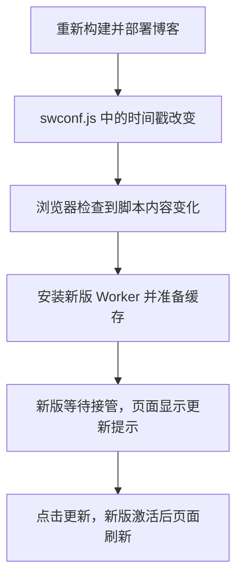

最近给博客左下角加了一个霍格沃茨魁地奇小场景。重新构建、部署之后，页面冒出一句：**“发现新版本的内容。”** 点击“更新”，页面刷新，新场景就出现了。

一个静态博客，怎么还会自己发现更新？难道它一直盯着我的 GitHub？

答案藏在 Chirpy 自带的 **PWA / Service Worker 更新机制**里：浏览器检查到新版 Service Worker，主题显示提示；读者点击更新后，新版本接管，页面再刷新。

下面就拿这个博客当 Demo，顺着代码拆开看。只要懂一点 JavaScript，就能跟上。

> 本文基于本博客使用的 Chirpy 7.3.0 及其现有代码。文中的源码链接固定在文章编写时的提交，不同版本的主题实现可能有差异。
{: .prompt-info }

## 1. 先认识三位主角

- **PWA**：Progressive Web App，渐进式 Web 应用。它是一组让网站具有安装、离线访问等体验的能力，不是某一个 JavaScript 文件。
- **Service Worker**：浏览器运行的一段独立脚本，可以拦截它所控制页面的请求、处理缓存。它不能直接操作页面 DOM。
- **Cache Storage**：保存请求和响应的存储空间。Service Worker 可以用它缓存 HTML、CSS、JavaScript 等资源。

可以把 Service Worker 想成请求途中的小管家：页面要拿资源时，它先看看本地有没有。它按事件被唤醒，并不需要一直运行；读者也不必把博客安装到桌面，在浏览器中访问就能使用这套机制。[MDN：Service Worker 入门](https://developer.mozilla.org/en-US/docs/Web/API/Service_Worker_API/Using_Service_Workers)

本博客的主要策略是 **Cache First（缓存优先）**：

```text
页面请求资源
  ├─ 缓存命中 → 直接返回缓存
  └─ 没有缓存 → 请求网络，符合条件的响应再存入缓存
```

这解释了一个熟悉的现象：**服务器已经部署新内容，打开的页面却还可能使用旧缓存。** 所以，缓存之外还需要一套版本切换机制。

这里的 Cache Storage 与浏览器依据 `Cache-Control` 管理的 HTTP 缓存是两回事，后面排查更新时会用到这个区别。

## 2. 在博客里找到入口

本博客的 [`_config.yml`](https://github.com/PigKnightX/PigKnightX.github.io/blob/aaf038a7539726674c9c4622d902bd620c30f17a/_config.yml) 开启了 PWA 和离线缓存：

```yaml
pwa:
  enabled: true
  cache:
    enabled: true
```

先记住这几份文件，不用急着通读：

| 源文件 | 作用 |
| --- | --- |
| `_includes/head.html` | 引入 PWA 脚本 |
| `_javascript/pwa/app.js` | 注册、弹窗和刷新 |
| `_javascript/pwa/sw.js` | Worker 的生命周期与缓存 |
| `assets/js/data/swconf.js` | 缓存名称与预缓存清单 |
| `_includes/notification.html` | 更新提示框 |

源码经过打包和 Jekyll 构建后，浏览器访问的是根目录下的 `/app.min.js`、`/sw.min.js`，以及 `/assets/js/data/swconf.js`。

页面注册 Worker 的核心只有一行。以本博客空的 `baseurl` 为例，相当于：

```js
navigator.serviceWorker.register('/sw.min.js');
```

`register()` 告诉浏览器：请为这个网站注册这份脚本。脚本放在根目录，默认作用范围就是本站根路径及其子路径。

**本博客只在生产环境加载这段 PWA 页面脚本。** GitHub Pages 的部署流程使用了 `JEKYLL_ENV=production`；普通的本地开发预览，在没有历史注册的情况下，不会出现这套更新提示。[对应模板](https://github.com/PigKnightX/PigKnightX.github.io/blob/aaf038a7539726674c9c4622d902bd620c30f17a/_includes/head.html)

## 3. 页面凭什么知道“有新版”？

### 每次构建，留下一个时间戳

打开 [`swconf.js` 的源文件](https://github.com/PigKnightX/PigKnightX.github.io/blob/aaf038a7539726674c9c4622d902bd620c30f17a/assets/js/data/swconf.js)，会看到这行 Liquid 模板：

```liquid
cacheName: 'chirpy-{{ "now" | date: "%s" }}',
```

Jekyll 构建时，会把它变成类似这样的 JavaScript：

```js
cacheName: 'chirpy-1794307200',
```

后面的数字是构建时的 Unix 时间戳，单位为秒。下一次构建，只要时间戳不同，生成的 `swconf.js` 内容就不同，缓存名称也随之改变。

所以，**即使文章一字未改，稍后重新构建并部署，也可能触发更新提示。** 这个名称记录的是构建时间，不是文章内容的哈希，也不是 Git 提交编号。

### 浏览器比较的是脚本内容

Worker 在开头加载了这个配置文件：

```js
importScripts('./assets/js/data/swconf.js');
```

浏览器检查 Service Worker 更新时，会比较主脚本及其导入脚本的内容。即使 `/sw.min.js` 没变，只要检查时获取到的 `swconf.js` 变了，也能发现新版本。[浏览器的更新流程](https://developer.chrome.com/docs/workbox/service-worker-lifecycle#updates)

这就接上了整条链：



注意中间的“**浏览器检查到**”。这份 Chirpy 代码没有通过 WebSocket 接收发布消息，也没有自己设置一个固定间隔的轮询定时器。页面导航、再次调用 `register()` 等会给浏览器触发更新检查的机会，但**部署完成不代表所有打开的标签页都会立刻弹窗**。

更细一点：导入脚本的更新检查还可能受到 HTTP 缓存影响。默认的 `updateViaCache: 'imports'` 允许检查导入脚本时使用 HTTP 缓存，因此不能把它理解成“每次都立即拿到服务器最新文件”。[MDN：updateViaCache](https://developer.mozilla.org/en-US/docs/Web/API/ServiceWorkerRegistration/updateViaCache)

## 4. 发现新版，为什么不直接刷新？

因为读者可能正在读文章。新版准备好了，先等一个合适的切换时机。

在旧 Worker 已经控制页面的情况下，新版本通常会经历：

| 阶段 | 本博客在做什么 |
| --- | --- |
| **installing：安装中** | 准备新版本的预缓存资源 |
| **waiting：等待接管** | 旧版继续控制页面 |
| **activating → activated：激活** | 清理旧缓存、完成交接 |

安装阶段的核心代码是：

```js
event.waitUntil(
  caches.open(swconf.cacheName).then((cache) => {
    return cache.addAll(swconf.resources);
  })
);
```

`waitUntil()` 让浏览器等待这项异步工作。只有预缓存成功，安装才算成功；如果这里失败，新版就不能正常完成安装，旧版可以继续工作。

预缓存清单包含首页、主题样式、导航页面及指定的静态资源。**它没有提前下载全站所有文章。** 其他资源通常在访问时，按请求处理逻辑进入缓存，因此“支持离线”不等于“没看过的内容也全部能离线打开”。[Worker 源码](https://github.com/PigKnightX/PigKnightX.github.io/blob/aaf038a7539726674c9c4622d902bd620c30f17a/_javascript/pwa/sw.js)

接着，页面脚本监听安装状态。下面是 [`app.js`](https://github.com/PigKnightX/PigKnightX.github.io/blob/aaf038a7539726674c9c4622d902bd620c30f17a/_javascript/pwa/app.js) 中的相关逻辑，合并了两层判断以便阅读：

```js
registration.addEventListener('updatefound', () => {
  registration.installing.addEventListener('statechange', () => {
    if (registration.waiting && navigator.serviceWorker.controller) {
      popupWindow.show();
    }
  });
});
```

这里有三个关键点：

- `updatefound`：浏览器开始安装一个 Worker，不代表安装已经成功。
- `registration.waiting`：已经有安装完成、正在等待的 Worker。
- `navigator.serviceWorker.controller`：当前页面已经由一个 Worker 控制。

因此，第一次访问通常只是安装初始版本，不会被提示“发现新版本”。而老访客遇到一个等待接管的新版本，才会看到熟悉的小弹窗。

## 5. 点击“更新”，到底发生了什么？

这个按钮完成的是一次“交接班”。页面脚本先向等待中的 Worker 发消息：

```js
registration.waiting.postMessage('SKIP_WAITING');
```

Worker 收到消息后，调用浏览器 API：

```js
self.addEventListener('message', (event) => {
  if (event.data === 'SKIP_WAITING') {
    self.skipWaiting();
  }
});
```

`SKIP_WAITING` 是这两段代码约定的消息字符串；真正起作用的是 `skipWaiting()`。它让已经安装好的新版跳过等待，开始激活，**不会跳过安装，也不会自己刷新页面**。[MDN：skipWaiting()](https://developer.mozilla.org/en-US/docs/Web/API/ServiceWorkerGlobalScope/skipWaiting)

新版激活时，Chirpy 删除名称不同于当前 `cacheName` 的缓存。随后，页面发现控制自己的 Worker 变了，触发 `controllerchange`，才执行刷新：

```js
let refreshing = false;

navigator.serviceWorker.addEventListener('controllerchange', () => {
  if (!refreshing) {
    window.location.reload();
    refreshing = true;
  }
});
```

这个标记用来避免同一页面重复触发刷新。重新加载后，页面请求就会使用新版 Worker 的缓存逻辑。

也就是说，顺序是：**点击按钮 → 发消息 → 新版激活 → 控制者改变 → 页面刷新**。只调用一次普通刷新，并不一定能让等待中的 Worker 接管。

如果不点击按钮，等所有由旧 Worker 控制的页面关闭后，新版也可以结束等待、自动激活。

如果同时开了多个博客标签页，其他由旧 Worker 控制、也监听了 `controllerchange` 的页面同样可能刷新。这个更新影响的是同一注册下的页面，不只是一枚按钮所在的标签页。

## 6. 动手实验：让博客弹一次更新提示

下面在博客仓库的本地副本里操作，需要已经装好项目的 Ruby 和 Bundler 依赖。选一个没有用过的端口，可以减少历史缓存干扰。

### 第一步：用生产模式启动

```bash
JEKYLL_ENV=production bundle exec jekyll serve --host 127.0.0.1 --port 4001
```

打开 `http://127.0.0.1:4001/about/`。Service Worker 通常要求 HTTPS，本地回环地址可以用于开发测试。

在 Chrome DevTools 的 **Application → Service Workers** 中，等待初始 Worker 激活，然后刷新一次页面。控制台执行：

```js
navigator.serviceWorker.controller?.scriptURL
```

应该看到以 `/sw.min.js` 结尾的地址。如果是 `undefined`，当前页面还没有被控制，先检查注册是否成功。实验过程中一直使用同一个地址和端口，不要在 `localhost` 与 `127.0.0.1` 之间切换。

> 演示时保持 DevTools 的 **Update on reload** 和 **Bypass for network** 关闭，才能观察网站本身的更新流程。
{: .prompt-tip }

### 第二步：造一个看得见的新版本

保持浏览器标签页打开，在本地源文件 `_tabs/about.md` 末尾临时加一句：

```markdown
PWA 实验：这是第二版页面。
```

等待终端提示重新构建完成。这次构建会生成新的缓存名称；先不要刷新旧页面。

### 第三步：主动检查更新

为了不等浏览器自行安排检查，在当前页面的控制台执行：

```js
const registration = await navigator.serviceWorker.getRegistration();
await registration.update();
```

`update()` 发起一次更新检查，不会直接激活新版。等待安装完成后，应能看到更新弹窗；此时再执行下面一行，通常会得到 `"installed"`：[MDN：update()](https://developer.mozilla.org/en-US/docs/Web/API/ServiceWorkerRegistration/update)

```js
registration.waiting?.state
```

这并不矛盾：`waiting` 是注册对象上的位置，`installed` 是放在这个位置里的 Worker 的状态。

### 第四步：点击更新，观察交接

点击页面里的“更新”，页面自动刷新，刚才添加的实验文字出现。再到 **Application → Cache Storage** 查看，可以看到当前的 `chirpy-时间戳` 缓存；激活完成后，旧名称的缓存应被清理。

实验结束后，删除那句临时文字。若想恢复不受本次实验缓存影响的本地预览，可以只对这个测试地址，在 DevTools 中注销 Worker，并删除它的 Cache Storage。

## 7. 遇到这些现象，先看哪里？

- **本地没有更新弹窗**：是否用了生产模式？当前页面是否已有 `controller`？第一次安装通常不提示更新。
- **推送后暂时没有提示**：部署是否成功？浏览器是否已检查更新？导入脚本的 HTTP 缓存是否仍有效？
- **开始安装，却没有进入等待**：看 DevTools 的错误和 Network，确认预缓存资源没有请求失败。
- **关闭弹窗，下次又出现**：关闭按钮只是隐藏提示；如果新版仍在 `waiting`，Chirpy 会再次展示它。
- **刷新了，内容还是旧的**：旧 Worker 可能仍在控制页面，并从 Cache Storage 返回旧响应；检查是否有等待中的新版。

读到这里，再看到那句“发现新版本的内容”，就可以把它翻译成一句更准确的话：

> **新的 Service Worker 已经安装好了，正在等你允许它接管。**

静态博客负责生成文件，浏览器负责检查和管理 Worker，Chirpy 把缓存切换与页面提示连接起来。一个小弹窗，正好串起了从构建、缓存到页面刷新的完整过程。
