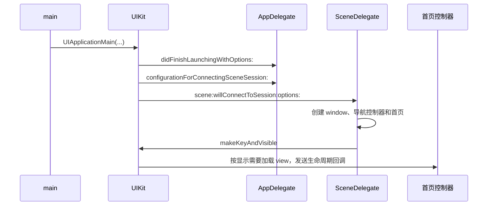
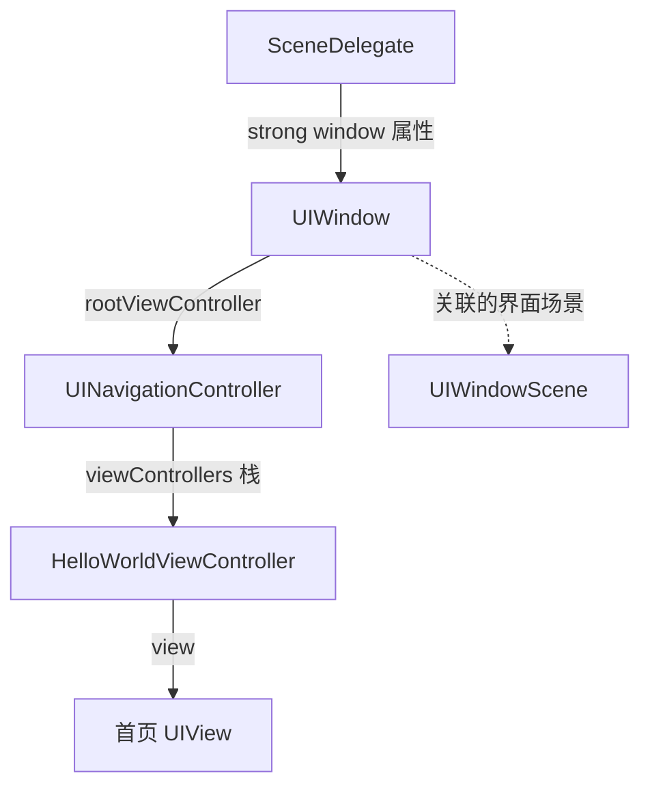

这个系列面向会 React、没有写过 iOS 的开发者。我们从一个原生 Hello World 页面开始，把 React Native 页面接进来，再拆解 JS Bundle 和公共包。

本篇使用 Objective-C 和 UIKit，通过代码创建界面。完成后，App 会显示一个带原生导航栏的首页。示例采用 Scene 生命周期；后续的 RN 页面也由这套原生结构承载。

[下载系列示例源码]()。压缩包按文章阶段提供代码，`03-native` 包含前三篇的完整原生工程；本篇只展开其中的启动与首页部分。

## 系列目录

1. [App 启动与基本骨架]()
2. [Objective-C 的对象与事件]()
3. [UIKit 布局、生命周期与导航]()
4. [第三方依赖与工程文件]()
5. [在 iOS 中运行 RN 页面]()
6. [iOS 与 RN 双向通信]()
7. [Metro、Hermes 与离线运行]()
8. [多入口与独立 Bundle]()
9. [公共包、业务包与共享 Runtime]()

## 1. 一个 App 里，有三种不同的问题

iOS 启动一个 App，需要处理进程、界面和页面三个层次的工作。

| 层次 | 要解决的问题 | 本例中的对象 |
| --- | --- | --- |
| 进程 | 应用如何启动，如何接收系统事件 | `main`、`UIApplication`、`AppDelegate` |
| 界面场景 | 一份界面何时连接、进入前台、断开 | `UIScene`、`SceneDelegate` |
| 页面 | 显示什么内容，如何切换页面 | `UIWindow`、`UINavigationController`、`UIViewController` |

浏览器替前端程序处理了窗口和事件循环。写 UIKit 时，这些层次会出现在项目代码里。程序需要告诉 UIKit：哪个对象接收应用事件、哪个对象配置界面、最先显示哪个页面。

Scene 表示一份 UI 场景。一个进程可以支持多份场景，例如 iPad 上同一 App 的两个窗口。本系列关闭多窗口能力，只创建一个窗口，但保留 Scene 生命周期。**AppDelegate 处理应用级事件，SceneDelegate 处理这份界面的事件。** 两者的范围不同。

## 2. 启动回调与对象关系，要分开看

下面是启动时的主要调用关系。箭头表示调用或回调，不表示对象持有关系。



`UIApplicationMain` 进入 UIKit 管理的应用运行过程。它建立应用对象及代理，并运行主事件循环。用户点击、系统通知、页面显示等事件，随后通过这套机制派发。启动代码执行完后，进程仍会等待和处理事件。

Scene 的配置与连接发生在 UIKit 的管理下。`AppDelegate` 返回配置，UIKit 根据配置创建并连接场景。代码没有手动调用 `SceneDelegate` 的生命周期方法。

界面创建完成后的引用关系如下。实线只画出本例中需要关心的强引用。



`UIWindow` 是界面内容的容器，也参与事件分发。它需要一个根控制器。根控制器负责组织窗口里的内容，具体页面再用 `UIView` 及其子视图绘制界面。Apple 对窗口职责的说明见 [UIWindow 文档](https://developer.apple.com/documentation/uikit/uiwindow)。

这些对象的生命周期也不相同。应用级服务通常在进程范围内复用，窗口服务于对应场景，页面控制器随导航变化。将来创建 RN 运行环境时，需要明确它应该跟随进程还是页面；只知道页面显示了什么，还不足以决定运行环境放在哪里。

首页被放进 `UINavigationController` 后，导航控制器就是窗口的根控制器。首页是它管理的第一个页面。后续增加第二页、RN 页时，可以继续向这个导航栈压入控制器。

Scene 与 Scene Session 也有区别。Session 记录一份场景会话的身份和配置，场景对象则参与当前的 UI 连接。系统断开场景连接时，进程未必退出。应用需要恢复窗口状态时，可以围绕会话保存和恢复数据；Hello World 没有这类状态。

这种划分避免了把所有工作塞进一个入口回调：进程只启动一次，界面却可能反复进入前台，也可能重新连接。页面还会随着导航独立创建和释放。把日志放在相应层次，才能解释事件到底发生在哪个范围。

## 3. main：把程序交给 UIKit

项目入口是 `main.m`：

```objc
#import <UIKit/UIKit.h>
#import "AppDelegate.h"

int main(int argc, char *argv[]) {
    @autoreleasepool {
        return UIApplicationMain(
            argc,
            argv,
            nil,
            NSStringFromClass([AppDelegate class])
        );
    }
}
```

`UIApplicationMain` 的第三个参数决定应用对象的类，传 `nil` 表示使用 `UIApplication`。第四个参数是应用代理的类名。`NSStringFromClass` 把 `AppDelegate` 类转换成类名字符串，UIKit 据此创建代理对象。

`@autoreleasepool` 参与 Objective-C 对象的内存管理。应用入口沿用这段标准结构即可。页面内的对象通常由 ARC 自动管理，第二篇会说明它与对象引用的关系。

前端项目里的入口文件通常负责挂载 React 根组件。这里的入口把执行权交给 UIKit，界面搭建发生在后续的 Scene 回调中。

## 4. AppDelegate：系统事件的接收者

头文件声明一个类，并说明它遵守 `UIApplicationDelegate` 协议：

```objc
// AppDelegate.h
#import <UIKit/UIKit.h>

@interface AppDelegate : UIResponder <UIApplicationDelegate>
@end
```

实现文件提供启动回调和 Scene 配置：

```objc
// AppDelegate.m
#import "AppDelegate.h"

@implementation AppDelegate

- (BOOL)application:(UIApplication *)application
        didFinishLaunchingWithOptions:(NSDictionary *)launchOptions {
    NSLog(@"App 启动完成");
    return YES;
}

- (UISceneConfiguration *)application:(UIApplication *)application
        configurationForConnectingSceneSession:(UISceneSession *)session
        options:(UISceneConnectionOptions *)connectionOptions {
    return [[UISceneConfiguration alloc]
            initWithName:@"Default Configuration"
            sessionRole:session.role];
}

@end
```

Delegate 翻译为“代理”。UIKit 掌握事件发生的时机，我们提供一个对象，替应用响应这些事件。例如，UIKit 知道应用何时完成启动，就向代理发送启动回调。协议定义了双方约定的方法。

这种设计允许 UIKit 保持通用。不同 App 只需要实现自己的代理行为，无须修改系统的 `UIApplication` 实现。Apple 的 [Delegation 说明](https://developer.apple.com/library/archive/documentation/General/Conceptual/DevPedia-CocoaCore/Delegation.html)介绍了这种协作方式。

方法名很长，是 Objective-C 把参数名写进方法名的结果。上面第二个方法的完整名称是 `application:configurationForConnectingSceneSession:options:`，第二篇会专门拆解这种语法。

## 5. SceneDelegate：连接窗口与页面

`SceneDelegate.h` 保留一个强引用的窗口属性：

```objc
#import <UIKit/UIKit.h>

@interface SceneDelegate : UIResponder <UIWindowSceneDelegate>
@property (strong, nonatomic) UIWindow *window;
@end
```

`SceneDelegate.m` 完成界面初始化：

```objc
#import "SceneDelegate.h"
#import "HelloWorldViewController.h"

@implementation SceneDelegate

- (void)scene:(UIScene *)scene
        willConnectToSession:(UISceneSession *)session
        options:(UISceneConnectionOptions *)connectionOptions {
    if (![scene isKindOfClass:[UIWindowScene class]]) {
        return;
    }

    UIWindowScene *windowScene = (UIWindowScene *)scene;
    UIWindow *window = [[UIWindow alloc] initWithWindowScene:windowScene];
    HelloWorldViewController *home = [[HelloWorldViewController alloc] init];
    UINavigationController *navigation = [[UINavigationController alloc]
            initWithRootViewController:home];

    window.rootViewController = navigation;
    self.window = window;
    [window makeKeyAndVisible];
}

@end
```

这段代码有四项工作：创建属于当前 Scene 的窗口、创建首页、建立导航栈、显示窗口。

`self.window = window` 让代理持续持有窗口。局部变量 `window` 只在方法内部可见，属性则保留了对象引用。`makeKeyAndVisible` 显示窗口，并使它成为接收相关输入事件的 key window。

`UINavigationController` 也是一个 ViewController，不过它负责管理其他控制器。它提供导航栏和页面栈。首页只需要处理自己的内容，不必同时实现返回按钮、页面入栈与出栈。

## 6. 首页：控制器管理一棵视图树

新建 `HelloWorldViewController.h`：

```objc
#import <UIKit/UIKit.h>

@interface HelloWorldViewController : UIViewController
@end
```

实现文件创建一个标签，并通过约束把它放在安全区域中心：

```objc
// HelloWorldViewController.m
#import "HelloWorldViewController.h"

@implementation HelloWorldViewController

- (void)viewDidLoad {
    [super viewDidLoad];
    self.title = @"iOS 学习 Demo";
    self.view.backgroundColor = UIColor.systemBackgroundColor;

    UILabel *label = [[UILabel alloc] init];
    label.text = @"Hello World";
    label.font = [UIFont systemFontOfSize:32 weight:UIFontWeightBold];
    label.translatesAutoresizingMaskIntoConstraints = NO;
    [self.view addSubview:label];

    UILayoutGuide *safeArea = self.view.safeAreaLayoutGuide;
    [NSLayoutConstraint activateConstraints:@[
        [label.centerXAnchor constraintEqualToAnchor:safeArea.centerXAnchor],
        [label.centerYAnchor constraintEqualToAnchor:safeArea.centerYAnchor]
    ]];
}

@end
```

`UIViewController` 管理页面的视图和生命周期。`self.view` 是页面的根视图，`UILabel` 是它的子视图。`viewDidLoad` 在控制器的视图加载完成后调用，适合创建这类页面固定结构。

安全区域与约束将在第三篇展开。本例使用系统提供的背景色，页面可以跟随系统的浅色或深色外观。

## 7. Info.plist 把 Scene 配置接起来

类已经写好，还需要告诉 UIKit 使用哪个 SceneDelegate。在 `Info.plist` 中加入：

```xml
<key>UIApplicationSceneManifest</key>
<dict>
    <key>UIApplicationSupportsMultipleScenes</key>
    <false/>
    <key>UISceneConfigurations</key>
    <dict>
        <key>UIWindowSceneSessionRoleApplication</key>
        <array>
            <dict>
                <key>UISceneClassName</key>
                <string>UIWindowScene</string>
                <key>UISceneConfigurationName</key>
                <string>Default Configuration</string>
                <key>UISceneDelegateClassName</key>
                <string>SceneDelegate</string>
            </dict>
        </array>
    </dict>
</dict>
```

`Default Configuration` 与 AppDelegate 返回的配置名称一致。`SceneDelegate` 是本例 Objective-C 类的运行时名称。

本例完全用代码创建页面。项目中不要同时保留入口 Storyboard 配置：检查 `UIMainStoryboardFile` 和 Scene 配置中的 `UISceneStoryboardFile`，移除它们。启动屏幕的配置属于另一件事，可以保留；启动屏幕不会充当首页控制器。

## 8. 在 Xcode 里运行

打开 `03-native` 目录下的 `HelloWorld.xcodeproj`。顶部选择 `HelloWorld` Scheme，再选择已经安装的 iPhone 模拟器，按 `⌘R`。这个阶段只用 UIKit，不需要安装 CocoaPods。

如果从 Xcode 模板新建项目，需要检查生成的界面框架。模板选项随 Xcode 版本变化，部分默认生成 SwiftUI。本系列的入口是 `main.m` 和 UIKit Scene，不能把这些文件直接追加到已有的 SwiftUI `@main` 入口旁边。使用随文工程可以保证入口和构建配置一致。

新建的 `.m` 文件需要加入应用 Target。在右侧 File Inspector 中检查 Target Membership。文件存在于磁盘，并不代表它一定参与编译。

### 工程文件如何变成 App

`HelloWorld.xcodeproj` 保存 Target、源文件引用和构建设置。Target 描述要产出什么，例如一个 iOS 应用；Scheme 描述这次构建和运行使用哪些 Target、配置与动作。顶部选择的模拟器则决定这次运行的目的设备。

构建时，Objective-C 源文件先被编译，再与 UIKit 等系统框架链接，最后生成 `.app` 应用包。包中包括可执行文件、Info.plist 和资源。模拟器运行的是这个构建产物，无法通过直接执行某个 `.m` 文件启动页面。

因此，源代码相同但 Target 设置不同，也可能出现启动差异。第一篇最相关的设置是：入口源文件参与编译、Info.plist 指向本例配置、产品类型是 iOS App。后面加入第三方库后，还会增加库的链接与构建顺序。

## 9. 用断点观察启动

在 `main`、`didFinishLaunchingWithOptions:`、`scene:willConnectToSession:options:` 和首页 `viewDidLoad` 内各放一个断点。停止 App 后重新运行，每次命中断点按继续执行。

这次实验能观察到：先进入程序入口，再接收应用和场景回调，最后为显示页面加载视图。`home` 对象创建完成与 `home.view` 加载完成是两个时刻；UIKit 可以按显示需要加载视图。

把 App 切到后台再回到前台，进程仍存活时不会重新经过 `main`。若在 SceneDelegate 中实现 `sceneDidEnterBackground:` 与 `sceneDidBecomeActive:`，可以观察这份场景的状态变化。

调试断点会暂停应用执行，点击按钮或继续切换界面之前，需要先恢复程序。每次冷启动命中的调用栈能说明当前是 UIKit 在回调代理，还是自己的代码在创建对象。Xcode 左侧 Debug Navigator 可以展开调用栈，区别这两种来源。

## 10. 白屏时检查哪一层

| 现象 | 优先检查 |
| --- | --- |
| Scene 回调没有命中 | `UIApplicationSceneManifest`、配置名称和代理类名是否一致 |
| Scene 回调执行了，界面仍为空 | 是否设置 `rootViewController`、保存 `window`、调用 `makeKeyAndVisible` |
| 出现找不到 Storyboard 的异常 | 是否残留入口 Storyboard 配置 |
| 修改文件后没有效果 | 文件是否属于应用 Target，运行的 Scheme 是否正确 |
| 首页出现，但没有导航栏 | 窗口根控制器是否为创建好的 `UINavigationController` |

---

下一篇：[Objective-C：读懂按钮事件与对象语法]()。
