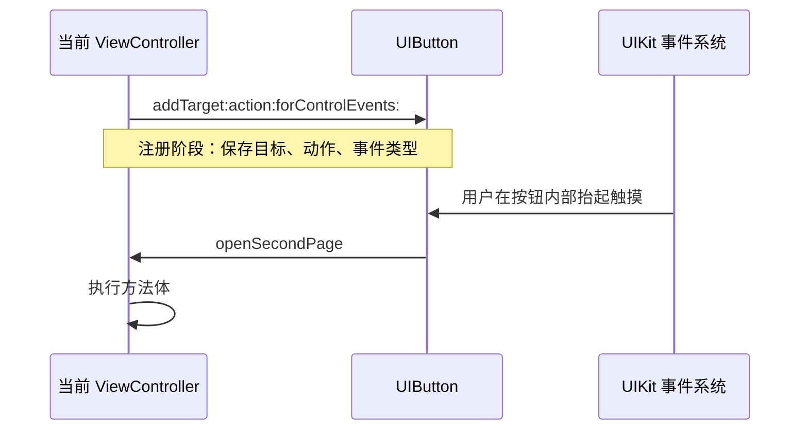

上一篇搭好了 UIKit App。本篇拆解示例中的 Objective-C 语法，重点是对象创建、方法调用和按钮事件。读者只需要 JavaScript 基础。

本篇代码对应[示例源码]()的 `03-native` 阶段。目标是能读懂首页按钮如何调用 `openSecondPage`，并能自己增加一个事件处理方法。

## 1. 方括号里面，是向对象发送消息

JavaScript 使用 `button.setTitle(...)` 这样的形式调用方法。Objective-C 常写成：

```objc
[button setTitle:@"打开第二页" forState:UIControlStateNormal];
```

它由接收者、方法名和参数组成：

```text
[接收者  第一段方法名:第一个参数  第二段方法名:第二个参数]
 button  setTitle: @"打开第二页"  forState: UIControlStateNormal
```

这个方法的完整名称是 `setTitle:forState:`。`forState` 是方法名的一部分，每个冒号对应一个参数位置。不能只搜索 `setTitle` 就认定找到了同一个方法。

Objective-C 把这种表达式称为发送消息。运行时根据接收者查找相应实现。用前端写法帮助理解，可以把上面一行想成：

```js
// 只用于理解参数位置，不是 Objective-C 的实际实现。
button.setTitleForState("打开第二页", UIControlStateNormal);
```

下面这句没有参数：

```objc
[window makeKeyAndVisible];
```

它的 selector 是 `makeKeyAndVisible`，没有冒号。下面这句有一个参数，selector 是 `addSubview:`：

```objc
[self.view addSubview:button];
```

## 2. 完整拆解按钮事件

首页注册点击事件的代码是：

```objc
[button addTarget:self
           action:@selector(openSecondPage)
 forControlEvents:UIControlEventTouchUpInside];
```

完整方法名为 `addTarget:action:forControlEvents:`，它接收三个参数：

| 方法名片段 | 传入值 | 含义 |
| --- | --- | --- |
| `addTarget:` | `self` | 事件发生时，向当前控制器发送消息 |
| `action:` | `@selector(openSecondPage)` | 要发送的消息名称 |
| `forControlEvents:` | `UIControlEventTouchUpInside` | 触摸在控件内部抬起时触发 |

UIKit 的 target-action 机制把三个信息保存起来：目标对象、动作 selector、事件类型。注册发生时不会执行 `openSecondPage`。



`self` 相当于方法执行期间的“当前对象”。首页的方法里，`self` 就是首页控制器。目标如果换成另一个对象，动作方法也需要由那个对象实现。

动作的实现如下：

```objc
- (void)openSecondPage {
    NSLog(@"按钮点击了");
}
```

`-` 表示实例方法，`void` 表示没有返回值，后面是方法名和方法体。类方法使用 `+`，例如 `[UIColor systemBlueColor]` 是向 `UIColor` 类发送消息。

Apple 的 [Target-Action 说明](https://developer.apple.com/library/archive/documentation/General/Conceptual/Devpedia-CocoaApp/TargetAction.html)介绍了目标、动作与控件的关系。

## 3. @selector 得到方法标识，不执行方法

下面三行做的事情不同：

```objc
SEL action = @selector(openSecondPage); // 得到 selector，类型是 SEL。
[self openSecondPage];                 // 现在执行这个方法。
NSString *name = NSStringFromSelector(action); // 得到名字字符串。
```

`SEL` 是方法名称的标识。它不包含某个对象的方法体，也没有绑定 `self`。UIKit 接到事件后，会把这个标识与 target 组合起来，向 target 发送对应消息。

这与 JavaScript 传函数有区别：

```js
button.addEventListener("click", openSecondPage);
```

JS 这里传的是函数值；Objective-C 这里传的是 selector，目标对象放在 `addTarget:` 参数里。方法名写错、冒号数量不对，都会影响运行时查找。

对于 `UIControl`，动作方法支持下面三种形式。`sender` 表示发出事件的控件，第二个参数可以接收事件对象；部分事件来源下事件对象可能为空。

```objc
// 不接收参数。
- (void)openSecondPage;
// 注册：@selector(openSecondPage)

// 接收 sender。
- (void)openSecondPage:(UIButton *)sender;
// 注册：@selector(openSecondPage:)

// 接收 sender 与 event。
- (void)openSecondPage:(UIButton *)sender forEvent:(UIEvent *)event;
// 注册：@selector(openSecondPage:forEvent:)
```

冒号属于 selector。`openSecondPage` 与 `openSecondPage:` 是不同的动作，不能互换。这三种是可选方案，在同一个按钮上选择一种即可。

## 4. .h、.m 与 .mm 分别放什么

头文件 `.h` 声明其他文件需要知道的接口，实现文件 `.m` 写方法体。

```objc
// HelloWorldViewController.h
#import <UIKit/UIKit.h>

@interface HelloWorldViewController : UIViewController
@end
```

`@interface` 声明类，冒号后是父类。这个控制器继承 `UIViewController`，因此获得页面视图、导航关联和生命周期等能力。

```objc
// HelloWorldViewController.m
#import "HelloWorldViewController.h"

@interface HelloWorldViewController ()
@property (nonatomic, copy) NSString *pageName;
@end

@implementation HelloWorldViewController

- (void)viewDidLoad {
    [super viewDidLoad];
    self.pageName = @"首页";
    self.title = self.pageName;
}

@end
```

`.m` 中的 `@interface 类名 ()` 是类扩展，适合声明只在该实现内部使用的属性。`@implementation` 开始实现部分，`@end` 结束对应结构。

`.mm` 使用 Objective-C++ 编译，允许同一个文件使用 Objective-C 和 C++。RN 的部分原生接口涉及 C++，接入时会遇到这种扩展名。普通 UIKit 页面使用 `.m` 即可。扩展名影响编译方式，把文件改成 `.mm` 本身不会完成 RN 集成。

### 声明里的类型与方法体

一个带参数和返回值的方法，可以写成 `- (NSString *)titleForPage:(NSInteger)index`。第一对括号描述返回类型，冒号后的括号描述参数类型，`index` 是方法体内部的变量名。selector 只包括 `titleForPage:`，不包括类型和变量名。修改参数变量名不会改变 selector。

`NSInteger` 是整数类型，`BOOL` 表示布尔值，`NSString *` 是对象引用。与 TypeScript 相比，这些类型不仅帮助检查调用，还参与编译为原生程序。编译器看到头文件中的声明后，才能检查其他文件怎样使用这个类。

头文件需要公开的是跨文件使用的契约。按钮只会触发的内部方法可以直接写在实现文件里。新增一个公开方法时，头文件声明与实现文件的方法签名应当一致，否则调用方看到的接口和实际实现可能不匹配。

## 5. alloc、init 与属性

创建一个对象的表达式经常有两层方括号：

```objc
UILabel *label = [[UILabel alloc] init];
```

先向 `UILabel` 类发送 `alloc`，分配一个实例；再向这个实例发送 `init`，完成初始化。可以拆成下面的阅读顺序：

```text
[UILabel alloc] → 分配实例
[刚得到的实例 init] → 初始化并返回可使用的对象
```

`UILabel *` 表示指向对象的指针，变量 `label` 保存对象引用。这里的 `*` 是声明的一部分。读取 `label.text` 仍然使用点语法。

```objc
label.text = @"Hello World";
self.title = @"首页";
```

Objective-C 的属性访问通常对应访问方法。`self.title = ...` 对应向 `self` 发送 `setTitle:` 消息，读取 `self.title` 则调用 getter。点语法与方括号语法会在同一个文件中出现。

`[super viewDidLoad]` 让父类执行对应实现。`super` 改变消息查找的起点，接收消息的仍是当前对象。

## 6. ARC 管理释放，引用关系决定生命周期

示例开启 ARC，编译器自动插入所需的引用管理操作。业务代码不手动调用 `retain`、`release` 或 `[super dealloc]`。属性的修饰词仍需要选择，因为它们影响对象之间的引用关系。

| 修饰词 | 对象关系 | 本系列的例子 |
| --- | --- | --- |
| `strong` | 保持强引用，引用存在时对象会被保留 | SceneDelegate 的 `window` |
| `weak` | 不保留对象；对象释放后引用自动归零 | 后续自定义 delegate 属性 |
| `copy` | 赋值时保存一份拷贝 | `NSString`、Block 属性 |
| `nonatomic` | 不要求属性访问器提供原子访问语义 | 本系列的 UI 属性 |

`copy` 字符串属性可以避免外部传入可变字符串后继续修改原内容，连带改变属性值。`nonatomic` 不表示“允许任意线程操作 UI”；UIKit 界面更新仍应放在主线程。

ARC 不会替程序解开循环引用。比如控制器强持有一个 Block 属性，Block 又捕获控制器，双方可能相互保留。需要回到实际引用关系判断是否使用 `weak`，不能给每个 Block 机械地套一段 `weakSelf`。

## 7. NSString、数组与字典字面量

`@"首页"` 是 `NSString` 对象字面量。普通 C 字符串是 `"首页"`，两者类型不同。UIKit 的标题、标签文本通常需要 `NSString`。

```objc
NSString *name = @"首页";
NSNumber *count = @3;
NSArray *pages = @[@"首页", @"第二页"];
NSDictionary *props = @{
    @"pageName": name,
    @"count": count,
    @"fromNative": @YES
};

NSLog(@"页面：%@，数量：%@", props[@"pageName"], props[@"count"]);
```

`@[]` 和 `@{}` 分别创建数组与字典，元素和值都是对象。数字要使用 `@3` 或 `@(expression)` 包装，布尔值可以使用 `@YES`。

向 `nil` 发送对象消息在 Objective-C 中是允许的；本系列关心的对象返回值会得到 `nil`。因此，`self.navigationController` 为空时发送 push 消息，可能只表现为没有跳转。排错需要检查接收者是否存在，而不能只查有没有抛出异常。

`nil` 表示没有对象。字典字面量不能放入 `nil` 值；如果数据协议确实需要表达显式空值，可以使用 `NSNull`，并由接收方按约定处理。后面向 RN 传 `initialProperties` 时，会再次用到这样的字典。

数组和字典字面量创建的是不可变集合。需要添加或删除元素时，使用 `NSMutableArray`、`NSMutableDictionary`，或先调用 `mutableCopy`。变量没有写 `const`，也不意味着它所指向的 Foundation 集合就可以修改；变量能否重新赋值与集合是否可变是两个问题。

`NSLog` 中 `%@` 打印 Objective-C 对象。打印整数时应使用匹配的格式与类型，例如 `%ld` 配合转换后的 `long`，避免把格式问题当作业务值异常。

## 8. Block 与协议：两种回调形式

Block 是可以作为值传递的代码块，概念上接近 JS 回调函数：

```objc
void (^printPage)(NSString *) = ^(NSString *pageName) {
    NSLog(@"当前页面：%@", pageName);
};

printPage(@"首页");
```

`void (^printPage)(NSString *)` 声明一个参数为字符串、无返回值的 Block 变量。`^(NSString *pageName) { ... }` 是 Block 本体。

UIKit 的动画 API 使用 Block 表达一段要执行的变化：

```objc
[UIView animateWithDuration:0.2 animations:^{
    button.alpha = 0.5;
}];
```

协议则适合描述对象之间的一组约定。下面只展示结构，完整页面不需要额外引入这个协议：

```objc
@class DetailController;

@protocol DetailControllerDelegate <NSObject>
- (void)detailControllerDidFinish:(DetailController *)controller;
@end

@interface DetailController : UIViewController
@property (nonatomic, weak) id<DetailControllerDelegate> delegate;
@end
```

`id<DetailControllerDelegate>` 表示一个遵守该协议的对象。详情控制器可以发送 `[self.delegate detailControllerDidFinish:self]`，具体由谁处理取决于赋给 `delegate` 的对象。系统的 `UIApplicationDelegate` 和 `UIWindowSceneDelegate` 也通过协议声明回调契约。

协议还可以声明 `@optional` 方法。接收方不保证实现可选方法，调用前通常需要用 `respondsToSelector:` 检查。`id<某协议>` 约束对象应遵守的接口，但不会替你创建对象、设置属性或触发回调。UIKit 的代理之所以有回调，是框架在相应时机主动发送消息。

Block 适合在一次 API 调用旁边写明后续工作，delegate 适合描述一个对象对外暴露的协作接口。本例的按钮使用第三种形式 target-action；三者都会出现在 iOS 项目里，实际使用形式由 API 的约定决定。

## 9. 一个不需要猜测的事件实验

把按钮改为带 `sender` 的形式：

```objc
[button addTarget:self
           action:@selector(openSecondPage:)
 forControlEvents:UIControlEventTouchUpInside];

// 放在 @implementation 内，且在其他方法体外。
- (void)openSecondPage:(UIButton *)sender {
    NSLog(@"selector：%@", NSStringFromSelector(_cmd));
    NSLog(@"sender：%@", sender);
    [sender setTitle:@"已经点击" forState:UIControlStateNormal];
}
```

`_cmd` 是当前方法的 selector。运行后点击按钮，控制台会打印方法名称，按钮标题会变化。这个结果同时验证了注册的事件、target 和 selector 能连接起来。

随后把注册改为 `@selector(openSecondPage)`，但保持实现带一个参数。编译器可能提示找不到 selector；若问题流入运行时，点击时会因 target 无法处理该消息而失败。恢复冒号后再运行。**修改动作参数时，声明、实现和注册三处需要保持一致。**

## 10. 语法问题的定位

| 现象 | 检查位置 |
| --- | --- |
| `Expected ...` 一类语法错误 | 方括号是否配对，参数之间是否误写了 JS 逗号 |
| 点击后出现 `unrecognized selector sent to instance` | target 的实际类、方法拼写和冒号数量 |
| 方法写好了，但按钮不响应 | 是否执行过注册，按钮是否可交互，是否被其他视图遮挡 |
| `undeclared identifier` | 变量作用域、头文件导入、方法是否写进了另一个方法体 |
| 字典创建时因空值异常 | 值是否为 `nil`，是否应省略该键或按协议使用 `NSNull` |

第三篇会把 `openSecondPage` 的日志换成真正的页面跳转。按钮事件只负责发出跳转意图，页面入栈和返回由 `UINavigationController` 管理。

---

上一篇：[App 启动与基本骨架]()。下一篇：[UIKit 页面、布局与导航]()。
