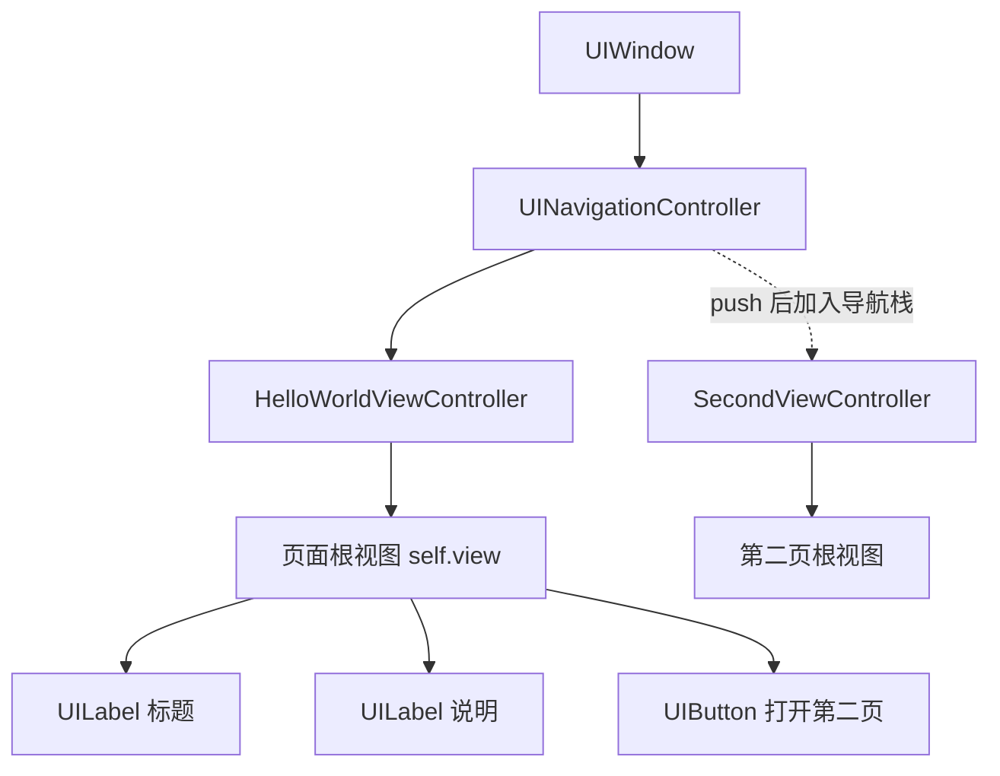
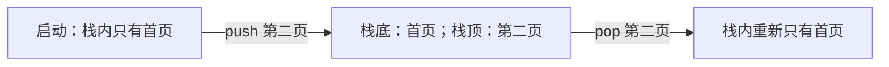

前两篇已经有了启动骨架，也拆解了按钮的 target-action 语法。本篇增加第二页，用原生 Auto Layout 排版，观察页面进入、离开和释放时分别发生什么。

[示例源码]()的 `03-native` 阶段包含完整工程。运行后，首页按钮进入第二页，第二页按钮返回首页。导航由 UIKit 管理，后续 RN 页面会沿用这条路径。

## 1. 控制器与视图，承担不同的工作

一个 UIKit 页面通常有一个控制器和一棵视图树。控制器管理生命周期、组织数据和事件；视图负责显示内容、布局和接收交互。



`[self.view addSubview:button]` 把按钮加入视图层级。它相当于为页面增加一个可显示的节点。对象仅仅被创建出来，还不会自动出现在界面上。

ViewController 之间也有容器关系。`UINavigationController` 管理子控制器，协调它们的显示和导航栏。`addSubview:` 只操作视图，不能代替控制器的 `push`。这两套层次在代码里有明确分工。

## 2. 布局描述关系

前端布局常把间距、宽度和对齐关系写进 CSS。Auto Layout 则通过约束描述视图之间的几何关系。

本例中的关系可以写成：

```text
标题左边 = 安全区域左边 + 24
标题右边 = 安全区域右边 - 24
标题顶部 = 安全区域顶部 + 48
说明顶部 = 标题底部 + 16
按钮顶部 = 说明底部 + 32
按钮高度 = 48
```

系统根据这些关系计算 `frame`。屏幕宽度改变时，左右边距仍保持 24，标签和按钮的宽度随可用区域变化。

安全区域 `safeAreaLayoutGuide` 描述当前视图中适合放置主要内容的区域。它会受到设备边缘、导航栏等因素影响。Safe Area 不等于键盘避让方案；输入页面还需要单独处理键盘布局。

### frame、bounds 与布局时机

`frame` 表示视图在父视图坐标系中的位置与尺寸，`bounds` 描述视图自己的坐标区域。约束计算完成后，才能稳定取得当前布局下的尺寸。`viewDidLoad` 适合创建视图，但此时不要依赖最终屏幕尺寸来计算业务布局。

UIKit 的长度单位通常是 point。point 与屏幕像素之间还隔着显示缩放比例。这里的 24 表示 24 point，不需要像处理位图资源那样手动乘上屏幕倍率。

当状态变化需要修改间距时，可以保留某条约束，更新它的 `constant`。不必每次都重新创建全部约束。若修改后需要立即取得新的布局结果，可在合适的视图上调用 `layoutIfNeeded`；它不会替代正确的约束关系。

## 3. 完整首页实现

沿用第一篇的 SceneDelegate，它把首页放进导航控制器。本篇首页头文件仍只声明继承关系：

```objc
// HelloWorldViewController.h
#import <UIKit/UIKit.h>

@interface HelloWorldViewController : UIViewController
@end
```

实现文件如下：

```objc
// HelloWorldViewController.m
#import "HelloWorldViewController.h"
#import "SecondViewController.h"

@implementation HelloWorldViewController

- (void)viewDidLoad {
    [super viewDidLoad];
    self.title = @"iOS 学习 Demo";
    self.view.backgroundColor = UIColor.systemBackgroundColor;

    UILabel *titleLabel = [[UILabel alloc] init];
    titleLabel.text = @"Hello World";
    titleLabel.font = [UIFont preferredFontForTextStyle:UIFontTextStyleLargeTitle];
    titleLabel.adjustsFontForContentSizeCategory = YES;
    titleLabel.numberOfLines = 0;

    UILabel *descriptionLabel = [[UILabel alloc] init];
    descriptionLabel.text = @"这是一个原生 UIKit 页面。点击按钮，进入第二页。";
    descriptionLabel.font = [UIFont preferredFontForTextStyle:UIFontTextStyleBody];
    descriptionLabel.adjustsFontForContentSizeCategory = YES;
    descriptionLabel.numberOfLines = 0;
    descriptionLabel.textColor = UIColor.secondaryLabelColor;

    UIButton *button = [UIButton buttonWithType:UIButtonTypeSystem];
    [button setTitle:@"打开第二页" forState:UIControlStateNormal];
    button.titleLabel.font = [UIFont preferredFontForTextStyle:UIFontTextStyleHeadline];
    [button addTarget:self
               action:@selector(openSecondPage)
     forControlEvents:UIControlEventTouchUpInside];

    titleLabel.translatesAutoresizingMaskIntoConstraints = NO;
    descriptionLabel.translatesAutoresizingMaskIntoConstraints = NO;
    button.translatesAutoresizingMaskIntoConstraints = NO;
    [self.view addSubview:titleLabel];
    [self.view addSubview:descriptionLabel];
    [self.view addSubview:button];

    UILayoutGuide *safe = self.view.safeAreaLayoutGuide;
    [NSLayoutConstraint activateConstraints:@[
        [titleLabel.topAnchor constraintEqualToAnchor:safe.topAnchor constant:48],
        [titleLabel.leadingAnchor constraintEqualToAnchor:safe.leadingAnchor constant:24],
        [titleLabel.trailingAnchor constraintEqualToAnchor:safe.trailingAnchor constant:-24],
        [descriptionLabel.topAnchor constraintEqualToAnchor:titleLabel.bottomAnchor constant:16],
        [descriptionLabel.leadingAnchor constraintEqualToAnchor:titleLabel.leadingAnchor],
        [descriptionLabel.trailingAnchor constraintEqualToAnchor:titleLabel.trailingAnchor],
        [button.topAnchor constraintEqualToAnchor:descriptionLabel.bottomAnchor constant:32],
        [button.leadingAnchor constraintEqualToAnchor:titleLabel.leadingAnchor],
        [button.trailingAnchor constraintEqualToAnchor:titleLabel.trailingAnchor],
        [button.heightAnchor constraintEqualToConstant:48]
    ]];
}

- (void)openSecondPage {
    SecondViewController *second = [[SecondViewController alloc] init];
    [self.navigationController pushViewController:second animated:YES];
}

@end
```

`translatesAutoresizingMaskIntoConstraints = NO` 关闭自动将 autoresizing mask 转换为约束的行为。我们已经自己提供了 Auto Layout 约束，应避免另一套自动生成的约束参与计算。

标签没有显式高度。`UILabel` 可以根据字体、文本和可用宽度提供内在内容尺寸；`numberOfLines = 0` 允许换行。按钮设置了固定高度，纵向位置来自说明文字的底部。

`leading` 与 `trailing` 是书写方向相关的起始边和结束边，比直接写 `left`、`right` 更适合支持不同语言方向。约束计算与锚点 API 的说明可参考 Apple 的 [Programmatically Creating Constraints](https://developer.apple.com/library/archive/documentation/UserExperience/Conceptual/AutolayoutPG/ProgrammaticallyCreatingConstraints.html)。

本例内容很短，没有滚动容器。内容增加到超出屏幕、或需要完整覆盖极大辅助字体时，应引入 `UIScrollView` 和相应内容约束；只给每个元素添加更多固定间距无法解决可用高度不足。

## 4. 第二页与返回操作

第二页头文件：

```objc
// SecondViewController.h
#import <UIKit/UIKit.h>

@interface SecondViewController : UIViewController
@end
```

实现文件使用相同的布局方法：

```objc
// SecondViewController.m
#import "SecondViewController.h"

@implementation SecondViewController

- (void)viewDidLoad {
    [super viewDidLoad];
    self.title = @"第二页";
    self.view.backgroundColor = UIColor.systemBackgroundColor;

    UILabel *label = [[UILabel alloc] init];
    label.text = @"这是第二个原生页面";
    label.font = [UIFont preferredFontForTextStyle:UIFontTextStyleTitle2];
    label.adjustsFontForContentSizeCategory = YES;
    label.numberOfLines = 0;

    UIButton *button = [UIButton buttonWithType:UIButtonTypeSystem];
    [button setTitle:@"返回首页" forState:UIControlStateNormal];
    [button addTarget:self
               action:@selector(goBack)
     forControlEvents:UIControlEventTouchUpInside];

    label.translatesAutoresizingMaskIntoConstraints = NO;
    button.translatesAutoresizingMaskIntoConstraints = NO;
    [self.view addSubview:label];
    [self.view addSubview:button];

    UILayoutGuide *safe = self.view.safeAreaLayoutGuide;
    [NSLayoutConstraint activateConstraints:@[
        [label.topAnchor constraintEqualToAnchor:safe.topAnchor constant:48],
        [label.leadingAnchor constraintEqualToAnchor:safe.leadingAnchor constant:24],
        [label.trailingAnchor constraintEqualToAnchor:safe.trailingAnchor constant:-24],
        [button.topAnchor constraintEqualToAnchor:label.bottomAnchor constant:32],
        [button.leadingAnchor constraintEqualToAnchor:label.leadingAnchor],
        [button.trailingAnchor constraintEqualToAnchor:label.trailingAnchor],
        [button.heightAnchor constraintEqualToConstant:48]
    ]];
}

- (void)goBack {
    [self.navigationController popViewControllerAnimated:YES];
}

@end
```

`self.navigationController` 指向包含当前页面的导航控制器。首页之所以能取得它，是第一篇通过 `initWithRootViewController:` 建立了容器关系。如果页面独立显示、没有进入导航容器，这个属性可以是 `nil`。

`pushViewController:animated:` 把控制器加入导航栈并显示它。`popViewControllerAnimated:` 移除栈顶控制器，显示前一个。导航栏上的系统返回按钮也使用这套导航关系。

### 事件如何到达按钮

触摸到达窗口后，UIKit 会结合视图层级、位置和可交互状态寻找命中的视图。按钮收到相关触摸并满足所注册的事件条件后，再向 target 发送 action。视图层级既决定显示，也影响交互。

如果按钮被另一个可交互视图覆盖，或者某一层关闭了 `userInteractionEnabled`，注册正确的 action 也可能收不到点击。排错时可以使用 Xcode 的视图调试检查层级，确认按钮的位置、大小和覆盖关系。

`UIControlEventTouchUpInside` 描述触摸在内部抬起的事件条件。业务代码注册这一事件，便无需自己编写按下、移动、抬起的触摸判断。需要处理拖动等连续输入时，再选择控件提供的其他事件或手势识别器。

## 5. 页面切换时，栈发生了什么



push 后，首页仍然在导航栈里，被导航控制器保留。返回时通常显示同一个首页实例，首页按钮、状态和已创建的视图也随它保留。

第二页 pop 后退出导航栈。如果没有其他强引用继续持有它，等转场等临时引用结束，就可以释放。这是对象引用关系的结果，不能只根据屏幕上是否还看得见页面来判断。

下一次再点击首页按钮，代码会重新 `alloc/init` 一个第二页。我们没有缓存之前的第二页对象。

导航栏显示由每个页面的 `navigationItem` 配置。`self.title` 会提供页面标题，系统可以根据栈关系生成返回入口。修改标题只是在配置显示信息，不会修改导航栈。第三篇的页面内容没有自己画导航栏，因此页面无需计算系统导航栏的固定高度。

如果在第二页连续执行两次 pop，第二次操作面对的就已经是新的栈状态。导航动作应与用户意图一一对应，避免同时让原生按钮和另一套路由逻辑处理同一次返回。后面接入 RN 时，仍由原生导航控制器执行这一步。

## 6. 生命周期对应的是不同阶段

| 方法 | 本例中的用途 | 可能再次发生的情况 |
| --- | --- | --- |
| `viewDidLoad` | 创建固定视图、注册按钮动作 | 同一份 view 加载完成时调用一次 |
| `viewWillAppear:` | 显示前刷新页面需要的数据 | 从第二页返回首页 |
| `viewDidAppear:` | 页面显示完成后的工作 | 页面再次显示 |
| `viewWillDisappear:` | 将要离开显示状态时的工作 | push、pop 或其他显示切换 |
| `viewDidDisappear:` | 视图离开显示状态后的工作 | 页面被其他页面覆盖 |
| `viewDidLayoutSubviews` | 布局完成后读取实际尺寸 | 旋转、尺寸变化或重新布局 |
| `dealloc` | 对象释放时的清理和调试 | 对象不再被强引用保留 |

**`viewDidDisappear:` 不表示控制器被销毁。** 首页 push 第二页后会离开显示状态，但仍然留在导航栈里。

`viewDidLayoutSubviews` 可以被调用多次。不要在其中反复 `addSubview:`、注册事件或无条件新增同一组约束。固定结构放在 `viewDidLoad`；确实依赖布局结果的计算，再放到布局回调中，并控制重复执行。

与容器相关的生命周期传递规则，可参考 Apple 的 [Implementing a Container View Controller](https://developer.apple.com/library/archive/featuredarticles/ViewControllerPGforiPhoneOS/ImplementingaContainerViewController.html)。自定义容器需要自己遵循这些规则，本系列使用系统提供的导航容器。

## 7. 用日志区分离开与释放

在两个控制器的 `viewDidLoad` 末尾都加上：

```objc
NSLog(@"%@ %p viewDidLoad", NSStringFromClass(self.class), self);
```

再分别加入以下方法：

```objc
- (void)viewWillAppear:(BOOL)animated {
    [super viewWillAppear:animated];
    NSLog(@"%@ %p viewWillAppear", NSStringFromClass(self.class), self);
}

- (void)viewDidDisappear:(BOOL)animated {
    [super viewDidDisappear:animated];
    NSLog(@"%@ %p viewDidDisappear", NSStringFromClass(self.class), self);
}

- (void)dealloc {
    NSLog(@"%@ %p dealloc", NSStringFromClass(self.class), self);
}
```

停止 App 后重新运行，执行“首页 → 第二页 → 首页 → 第二页”。观察类名与地址，而非只看回调次数。

首页第一次出现时加载视图，返回首页时再次经过显示回调。只要控制器和视图仍保留，返回并不要求重新执行首页的 `viewDidLoad`。

第二页每次由按钮创建一个实例。pop 后，如果没有额外持有，能观察到它最终执行 `dealloc`。转场期间可能存在临时引用，释放时机不应依赖某个日志之间的严格先后顺序。

还可以在首页的 `viewDidLayoutSubviews` 中增加日志，然后旋转模拟器或改变窗口尺寸。布局回调次数可能随显示和尺寸变化增加，首页控制器地址仍然相同。布局次数、显示次数与实例数量应分别观察。

再给首页增加一个强引用属性保存第二页，pop 后继续保留这个属性，第二页就无法按原先条件释放。把属性设回 `nil`，才能解除这条引用。这个实验把“导航栈移除了页面”和“页面对象释放了”区分开了。

## 8. 布局与导航的针对性排错

| 现象 | 检查方法 |
| --- | --- |
| 控制台出现约束冲突 | 查看冲突约束的对象与数值，确认没有同时启用相互矛盾的宽度、左右间距 |
| 元素位置不确定 | 检查水平和垂直方向是否都有足够关系，是否依赖不存在的内在尺寸 |
| 内容被导航栏挡住 | 检查顶部锚点连接的是根视图还是 `safeAreaLayoutGuide` |
| 按钮有日志但不跳页 | 打印 `self.navigationController`，检查 Scene 中的导航容器配置 |
| 返回后重复出现标签 | 检查是否在每次 appearance 或 layout 回调中重复创建视图 |
| pop 后一直没有 `dealloc` | 检查缓存属性、Block、计时器和其他强引用，而非把原因归给 pop 动画 |

本篇使用系统约束 API，代码较长，但每条语句都能对应到一个布局关系。下一篇引入 Masonry，把同样的关系换成更紧凑的写法，同时解释依赖加入工程后，为什么要通过 workspace 构建。

---

上一篇：[读懂 Objective-C 的对象与事件]()。下一篇：[第三方依赖与 CocoaPods]()。
