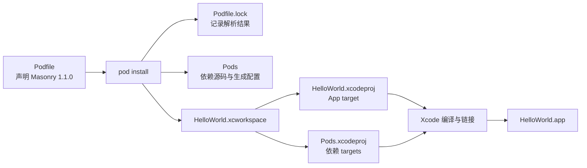
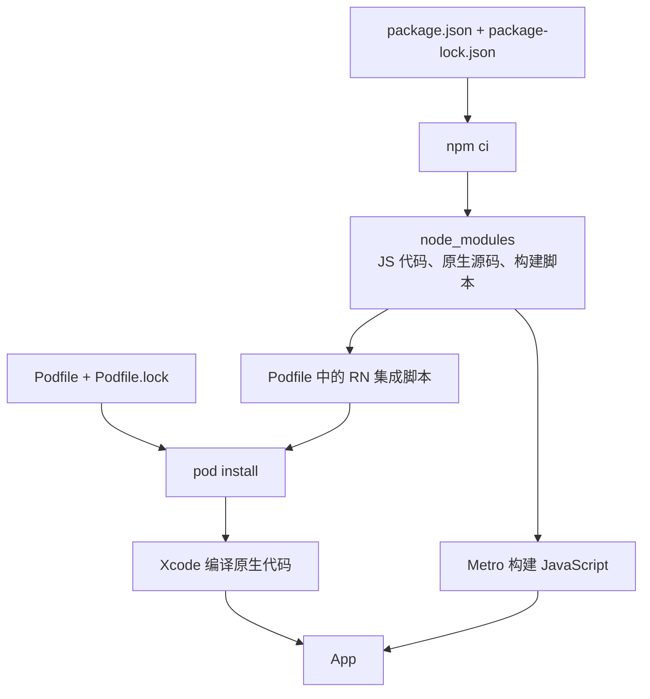

上一篇的 App 已经能打开两个原生页面。这一篇保留页面结构，用 Masonry 改写 Auto Layout 约束。页面外观不需要变化，工程里会多出依赖声明、锁文件和 workspace。

示例代码在[系列源码压缩包]()的 `04-dependencies` 目录。这个阶段只涉及原生依赖，还没有 React Native。需要 macOS、Xcode、一个可用的 iOS 模拟器，以及已经安装的 CocoaPods。Demo 的部署目标为 iOS 15.1，这是示例工程的配置。

## 依赖要进入编译和链接过程

前端项目安装一个包后，打包工具根据 `import` 寻找模块。Objective-C 的 `#import` 也需要找到声明，但仅有声明还不够。编译器要把源码编译成目标文件，链接器要把调用与实现连接起来，最后才能生成 App。

手动接入原生库，可能需要下载源码、添加文件引用、设置头文件搜索路径、配置链接选项，再处理库依赖的其他库。CocoaPods 根据依赖声明完成这些工程配置。它的输出会参与 Xcode 构建。

Masonry 提供了声明约束的 Objective-C API。它最终使用的仍然是 UIKit 的 Auto Layout。上一页的 `UILabel`、`UIButton`、导航控制器都继续保留。



## 用 Podfile 声明 Masonry

`Podfile` 放在 `HelloWorld.xcodeproj` 同一层。这个阶段的完整配置如下：

```ruby
source 'https://cdn.cocoapods.org/'

platform :ios, '15.1'

target 'HelloWorld' do
  pod 'Masonry', '1.1.0'
end

post_install do |installer|
  installer.pods_project.targets.each do |target|
    target.build_configurations.each do |configuration|
      configuration.build_settings['IPHONEOS_DEPLOYMENT_TARGET'] = '15.1'
    end
  end
end
```

`target 'HelloWorld'` 指定依赖要接到哪个构建目标上。Xcode 工程可以包含多个 target，例如 App、测试和扩展。把库加到 App target，测试或扩展不会因此自动获得相同配置。

`pod 'Masonry', '1.1.0'` 固定库的版本。这样文章代码和库的 API 能对应起来。这里没有使用版本范围，也没有在每次安装时自动追踪新版本。

`post_install` 在安装后统一 Pods 工程的部署目标。Masonry 自身声明的旧最低系统版本与本 Demo 的配置不同，这里将生成 target 的设置统一为 15.1。

在 `04-dependencies` 目录执行：

```bash
./setup.sh
open HelloWorld.xcworkspace
```

这个阶段的 `setup.sh` 在项目目录执行 `pod install`。安装完成后，在 Xcode 顶部选择 `HelloWorld` scheme 和一个 iPhone 模拟器，点击运行。源码同时提供 `./run.sh`，用来编译、安装和启动模拟器里的 App。

新增依赖后通常执行 `pod install`。它会结合现有锁文件安装依赖，并解析新加的声明。需要主动升级某个库时再使用 `pod update Masonry`。随手执行不带库名的 `pod update`，可能让整个依赖图发生变化，排查问题时会多出很多变量。

## 为什么改用 xcworkspace

`.xcodeproj` 描述一个 Xcode project：有哪些文件、target、Build Settings 和 Build Phases。原来的 HelloWorld 没有外部工程依赖，直接打开它就能完成构建。

`.xcworkspace` 可以把多个 project 放在同一个工作空间中。CocoaPods 创建的 workspace 同时引用 App 工程与 Pods 工程。打开 workspace 后，Xcode 才能在这套集成关系中构建所需的依赖 target。


引入 CocoaPods 后，日常入口改为 `HelloWorld.xcworkspace`。`HelloWorld.xcodeproj` 仍然存在，App 的 target 和构建阶段还在里面。workspace 引用它，并没有把它替换或复制一份。

如果双击 `.xcodeproj` 后出现 `Masonry/Masonry.h file not found` 或依赖构建相关错误，先关闭这个窗口，再从 workspace 打开。继续在两个窗口之间切换，很容易在一个窗口修改设置、在另一个窗口运行。

命令行也要选对入口：

```bash
xcodebuild \
  -workspace HelloWorld.xcworkspace \
  -scheme HelloWorld \
  -configuration Debug \
  -sdk iphonesimulator \
  -destination 'generic/platform=iOS Simulator' \
  CODE_SIGNING_ALLOWED=NO \
  build
```

这条命令只展示构建入口。安装到哪台模拟器、如何启动，由示例里的 `run.sh` 处理。

## 同一组约束的两种写法

上一篇把标题放在安全区域顶部以下 48 point，说明放在标题下方，按钮再放在说明下方。改用 Masonry 后，保留这些视图的创建代码，文件顶部增加：

```objc
#import <Masonry/Masonry.h>
```

三个视图添加到页面后，移除原有 `activateConstraints:` 代码和手动关闭 autoresizing mask 转换的设置，换成以下约束：

```objc
[titleLabel mas_makeConstraints:^(MASConstraintMaker *make) {
    make.top.equalTo(self.view.mas_safeAreaLayoutGuideTop).offset(48);
    make.left.equalTo(self.view.mas_safeAreaLayoutGuideLeft).offset(24);
    make.right.equalTo(self.view.mas_safeAreaLayoutGuideRight).offset(-24);
}];
[descriptionLabel mas_makeConstraints:^(MASConstraintMaker *make) {
    make.top.equalTo(titleLabel.mas_bottom).offset(16);
    make.leading.trailing.equalTo(titleLabel);
}];
[button mas_makeConstraints:^(MASConstraintMaker *make) {
    make.top.equalTo(descriptionLabel.mas_bottom).offset(32);
    make.leading.trailing.equalTo(titleLabel);
    make.height.mas_equalTo(48);
}];
```

`mas_makeConstraints:` 接收一个 block。Masonry 创建 `MASConstraintMaker`，把它传给 block，block 内部描述要建立的约束。`make.top.equalTo(...).offset(48)` 表示顶部相对目标增加 48 point，正好对应上一篇标题的顶部锚点约束。

这里的点语法和链式调用由 Objective-C 方法及 block 返回值组合而成。约束的结果仍然遵守 Auto Layout 的规则：位置、尺寸和优先级需要共同形成可求解的关系。

`make.leading.trailing.equalTo(titleLabel)` 同时声明前后两条对齐关系。`mas_equalTo(48)` 是 Masonry 处理数值参数的宏写法，这里把按钮高度固定为 48 point。说明到标题的 16 point、按钮到说明的 32 point 都与第三篇保持一致。

Masonry 1.1.0 为安全区域提供的是 `mas_safeAreaLayoutGuideLeft`、`Right` 等便利属性，没有 `mas_safeAreaLayoutGuideLeading` 和 `Trailing`。因此标题的安全区域约束使用 `left/right`；标签之间的 `leading/trailing` 对齐仍可使用。本例采用从左到右的布局，双向文字布局还要核对绝对左右与语义前后的差异。

Masonry 在创建约束时会关闭相关视图的 `translatesAutoresizingMaskIntoConstraints`。不需要再为这些视图重复关闭。修改写法后，仍要检查横屏、较大动态字体和安全区域，库不会自动补出缺失的布局条件。

## 哪些文件应该提交

依赖相关文件承担的职责不同：

| 文件或目录 | 职责 | 本 Demo 的处理 |
| --- | --- | --- |
| `Podfile` | 依赖声明和集成规则 | 提交 |
| `Podfile.lock` | 本次解析得到的版本和来源等信息 | 提交 |
| `HelloWorld.xcodeproj` | App 工程配置 | 提交 |
| `HelloWorld.xcworkspace` | App 与 Pods 的工作空间引用 | 提交共享配置 |
| `Pods/` | 下载的依赖和生成的依赖工程 | 不放进源码包，安装时生成 |
| `build/` | 编译产物和运行日志 | 不提交 |
| `xcuserdata/` | 本机用户的 Xcode 状态 | 不提交 |

锁文件要与声明一起保存。只保存 `Podfile`，无法完整表达某次安装解析出的传递依赖版本；只保存锁文件，也缺少依赖声明和集成脚本。是否把 `Pods/` 放进版本库可以按团队策略决定，本示例采用安装时生成的方式。

不要修改 `Pods/` 里的源码来永久修复问题。下一次安装或清理可能覆盖它，其他人的电脑也不会获得这项修改。需要修复库时，应通过可追踪的版本、补丁或源码引用表达。

## 接入 RN 后会有两层依赖

下一篇增加 `package.json` 和 `package-lock.json`，它们与 Podfile 同时存在。npm 安装 JavaScript 包到 `node_modules`，CocoaPods 把需要编译的 iOS 部分集成到工程里。



一个 npm 包可能只包含 JavaScript，也可能同时包含 Objective-C、Swift 或 C++。安装带原生实现的 RN 库后，通常还要执行 Pods 安装并重新编译 App。Metro 刷新只能更新当前运行环境里的 JavaScript，无法把新的原生机器码装进已安装的 App。

| 改动 | 需要的动作 |
| --- | --- |
| 修改纯 JS 页面，使用 Metro 开发模式 | 让 Metro 重新提供代码，通常可 Fast Refresh |
| 修改纯 JS 页面，使用内置 bundle | 重新生成 bundle 并构建安装 |
| 添加带 iOS 原生实现的 RN 包 | npm 安装、Pods 集成、重新编译安装 |
| 修改 `.m`、`.mm`、原生依赖或 Codegen 接口 | 必要时重新生成依赖，再重新编译安装 |

Swift Package Manager 也能管理原生依赖，Xcode 有对应的集成入口。选择库的接入方式时看它的发布形式和项目现有约定。本文固定使用 CocoaPods，同一个 Masonry 库不再通过另一套依赖系统重复安装。

## 工程、target、scheme 和设备是四个选择

打开 workspace 后，Xcode 顶部仍然需要选择 scheme 和运行设备。它们分别回答不同的问题，不能只检查窗口标题里有没有 workspace。

第一篇说明了 Project、target 与 scheme 的职责。加入依赖后，workspace 中也会出现库 target；运行设备则决定产物面向模拟器还是真机，以及最后安装到哪里。

本文运行的是 HelloWorld scheme。Pods 工程里的库 target 也可能出现在列表中，但构建一个依赖库不会启动 HelloWorld。模拟器构建也不会自动产生能安装到实体 iPhone 的同一份产物，二者的目标平台与签名条件不同。

Debug 和 Release 是构建配置。两者可以使用相同依赖声明，却有不同的优化、调试和脚本行为。之后 RN 集成里的 `#if DEBUG` 就由编译配置控制；它与选择哪台模拟器是两个独立条件。

## 从错误出现的阶段定位依赖问题

依赖安装成功，只表示依赖文件及集成配置已经准备好。App 能否编译通过，还需要检查源码使用的 API、部署目标、架构和链接关系。错误发生在哪个阶段，会决定应该查看哪份信息。

`pod install` 失败时，先看终端中 CocoaPods 的错误。它可能没有完成依赖解析或下载，这时 Xcode 使用的配置还没准备完整。反复点击运行，只会继续使用当前磁盘上的文件。

编译时提示某个头文件不存在，说明源码中的 `#import` 无法解析到声明。应检查依赖安装、target 归属和工作空间入口。能找到头文件却出现 `Undefined symbols`，则表示链接阶段找不到某些被调用的实现，还要查看对应实现是否参与构建与链接。

声明依赖、安装依赖和使用依赖是三个独立动作。Podfile 加了一行但没有安装，工程得不到新配置；安装了 Masonry 但源码没有调用它，页面行为也不会变化；源码写了调用但库没进入正确 target，编译或链接会暴露问题。

添加或删除 Pod、改变版本要求，以及从远程拉取了 Podfile 或锁文件变更以后，需要重新安装依赖。仅仅修改页面文案或约束常数，直接重新构建即可，不需要每次都重新执行安装。

源码包中的锁文件为这套教程提供可重复的依赖基线。升级库应作为独立改动，检查锁文件差异，再运行受影响的页面。依赖升级与页面重构同时发生时，某次构建失败就更难归因。

## 观察与排错

可以做一次只改变实现的实验：保留原来的页面文字和点击方法，仅把布局约束换成 Masonry。运行后依次检查首页、第二页、返回、横屏和大字体。页面行为应与原生约束版本对应，代码差异集中在约束声明和依赖配置。

如果提示 `The sandbox is not in sync with the Podfile.lock`，在 Podfile 所在目录执行 `pod install`，再从 workspace 构建。这条信息指向本机 Pods 与锁文件不一致，不需要立即删除锁文件或升级所有依赖。

如果出现布局冲突，查看 Xcode 控制台的 `Unable to simultaneously satisfy constraints`，对照参与冲突的视图和约束。Masonry 简化了声明方式，冲突的处理仍然是增删约束、补充尺寸或调整优先级。

参考：[CocoaPods 使用指南](https://guides.cocoapods.org/using/using-cocoapods.html)。

上一篇：[UIKit 布局与页面导航]()。下一篇：[把 RN 页面放进 iOS App]()。
