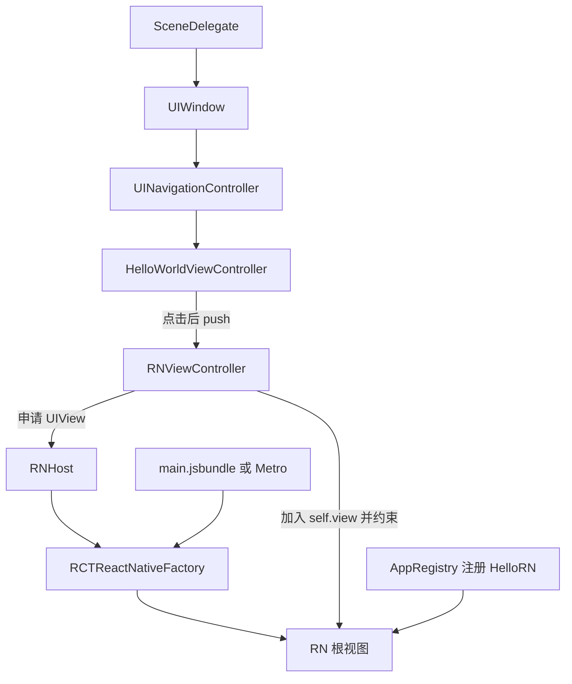

这个阶段在原生首页增加“打开 RN 页面”按钮。点击后，`UINavigationController` 打开一个原生控制器，控制器内部显示 React 编写的内容。窗口、导航栏和返回行为继续使用前几篇建立的 UIKit 结构。

本文使用示例锁文件中的 **React Native 0.88.1、React 19.3.0**。这些版本来自本机 Demo 的 `package-lock.json`，不表示阅读时的官方最新版本。集成代码按照这份安装版本的头文件编写，不能把旧项目 RN 0.69 的 `RCTBridge` 初始化代码直接混进来。

[系列源码压缩包]()中的 `05-rn` 是第 5—7 篇共用的完整代码，已经包含下一篇的原生通信演示。本篇只分析页面接入路径。依赖需要 Node、npm、CocoaPods、Python 3，以及带 iOS 模拟器运行环境的 Xcode；Node 版本范围见源码 `package.json` 的 `engines`。

## 原生控制器装入一块 RN 视图

RN 页面在 UIKit 中的入口是一块 `UIView`。原生控制器负责把它加入自己的视图树，再给它安排位置。React 则负责这块区域内部的组件、状态与交互。



`RNHost` 是 Demo 自己定义的类名，用来集中持有运行环境及配置。`RCTReactNativeFactory` 是 RN 提供的集成 API。两个名字中的 Host 和 Factory 不表示同一层对象。

App 的入口仍然从 `main.m` 进入 UIKit。集成 RN 不需要把整个 App 改成 RN 模板工程；增加一个能提供 RN 视图的对象，再把该视图装进现有控制器即可。

## 先把两层依赖装好

源码根目录同时放置 `package.json`、`Podfile` 和 `HelloWorld.xcodeproj`。`react-native.config.js` 指定 iOS 工程位于当前目录：

```js
module.exports = {
  project: {
    ios: {sourceDir: '.'},
  },
};
```

与本文有关的 npm 依赖固定为下面这些版本。源码包提供完整 `package.json` 和锁文件，不需要把这段配置另存成一个不完整的文件。

```json
{
  "dependencies": {
    "react": "19.3.0",
    "react-native": "0.88.1"
  },
  "devDependencies": {
    "@react-native-community/cli": "20.2.0",
    "@react-native-community/cli-platform-ios": "20.2.0",
    "@react-native/babel-preset": "0.88.1",
    "@react-native/metro-config": "0.88.1",
    "@react-native/typescript-config": "0.88.1"
  }
}
```

RN 包里还包含原生源码和 CocoaPods 脚本。Podfile 通过 Node 定位该脚本，让 npm 安装版本与原生集成脚本对应起来：

```ruby
source 'https://cdn.cocoapods.org/'

require Pod::Executable.execute_command('node', ['-p',
  'require.resolve("react-native/scripts/react_native_pods.rb", {paths: [process.argv[1]]})',
  __dir__
]).strip

platform :ios, min_ios_version_supported
prepare_react_native_project!

target 'HelloWorld' do
  config = use_native_modules!

  use_react_native!(
    :path => config[:reactNativePath],
    :app_path => __dir__
  )

  pod 'Masonry', '1.1.0'

  post_install do |installer|
    react_native_post_install(installer, config[:reactNativePath],
      :mac_catalyst_enabled => false)
    installer.pods_project.targets.each do |target|
      target.build_configurations.each do |build_config|
        build_config.build_settings['IPHONEOS_DEPLOYMENT_TARGET'] = min_ios_version_supported
      end
    end
  end
end
```

`use_native_modules!` 读取可自动链接的原生依赖信息；`use_react_native!` 接入 RN 自身的 Pods 与构建配置；`react_native_post_install` 完成它需要的后续工程设置。本机安装版本的 `min_ios_version_supported` 返回 `15.1`，与这个 Demo 的部署目标一致。

在解压后的 `05-rn` 目录执行：

```bash
./setup.sh
./run.sh
```

`setup.sh` 执行锁定依赖的 npm 安装，再执行 `pod install`，并为 Xcode 生成本机 Node 路径。`run.sh` 选择可用模拟器，使用 workspace 编译，安装并启动 App。首页点击“打开 RN 页面”，即可进入本篇分析的页面。默认从 App 内置 bundle 加载，不要求先启动 Metro。

也可以执行 `open HelloWorld.xcworkspace`，在 Xcode 选择 `HelloWorld` scheme 和模拟器后运行。首次依赖安装、原生编译都需要等待，错误信息分别出现在安装输出与 `build/build.log`。

## JavaScript 入口注册组件名

`index.js` 把根组件注册到 `AppRegistry`：

```js
import {AppRegistry} from 'react-native';
import App from './App';

AppRegistry.registerComponent('HelloRN', () => App);
```

`HelloRN` 是运行时注册名。它需要与 iOS 请求视图时的 `moduleName` 完全一致。`package.json` 的包名、文件名 `App.tsx`、Xcode 的 target 名都不承担这项匹配职责。

根组件的最小形态如下。源码中的完整页面还包含计数按钮和下一篇的通信演示。

```tsx
import React from 'react';
import {StyleSheet, Text, View} from 'react-native';

type AppProps = {greeting?: string; source?: string};

export default function App({greeting, source}: AppProps) {
  return (
    <View style={styles.page}>
      <Text>Hello React Native</Text>
      <Text>{greeting}</Text>
      <Text>来源：{source}</Text>
    </View>
  );
}

const styles = StyleSheet.create({
  page: {flex: 1, padding: 20, gap: 12},
});
```

## RNHost 持有 Factory 和 Delegate

`RNHost.h` 只暴露“创建 RN 视图”这个操作：

```objc
#import <UIKit/UIKit.h>

NS_ASSUME_NONNULL_BEGIN
@interface RNHost : NSObject
+ (instancetype)sharedHost;
- (UIView *)viewWithModuleName:(NSString *)moduleName
            initialProperties:(nullable NSDictionary *)initialProperties;
@end
NS_ASSUME_NONNULL_END
```

下面是单 bundle 阶段的 `RNHost.mm`。`.mm` 表示 Objective-C++，可以包含 RN 头文件涉及的 C++ 声明。

```objc
#import "RNHost.h"
#import <React/RCTBundleURLProvider.h>
#import <React/RCTBundleManager.h>
#import <React/RCTDevMenu.h>
#import <React-RCTAppDelegate/RCTDefaultReactNativeFactoryDelegate.h>
#import <React-RCTAppDelegate/RCTReactNativeFactory.h>
#import <ReactAppDependencyProvider/RCTAppDependencyProvider.h>

@interface DemoReactNativeDelegate : RCTDefaultReactNativeFactoryDelegate
@end

@implementation DemoReactNativeDelegate
- (NSURL *)bundleURL {
#if DEBUG
    if ([[NSProcessInfo processInfo].environment[@"RN_USE_METRO"]
         isEqualToString:@"1"]) {
        return [RCTBundleURLProvider jsBundleURLForBundleRoot:@"index"
            packagerHost:@"localhost:8082"
            enableDev:YES enableMinification:NO inlineSourceMap:NO];
    }
#endif
    return [[NSBundle mainBundle] URLForResource:@"main"
                                  withExtension:@"jsbundle"];
}

- (NSURL *)sourceURLForBridge:(RCTBridge *)bridge {
    return [self bundleURL];
}
@end

@interface RNHost ()
@property (nonatomic, strong) DemoReactNativeDelegate *delegate;
@property (nonatomic, strong) RCTReactNativeFactory *factory;
@property (nonatomic, strong) RCTBundleConfiguration *bundleConfiguration;
@property (nonatomic, strong) RCTDevMenuConfiguration *devMenuConfiguration;
@end

@implementation RNHost
+ (instancetype)sharedHost {
    static RNHost *host;
    static dispatch_once_t onceToken;
    dispatch_once(&onceToken, ^{ host = [[RNHost alloc] init]; });
    return host;
}

- (instancetype)init {
    self = [super init];
    if (self) {
        BOOL usesMetro = NO;
#if DEBUG
        usesMetro = [[NSProcessInfo processInfo].environment[@"RN_USE_METRO"]
                     isEqualToString:@"1"];
#endif
        RCTBundleURLProviderAllowPackagerServerAccess(usesMetro);
        _delegate = [[DemoReactNativeDelegate alloc] init];
        _delegate.dependencyProvider = [[RCTAppDependencyProvider alloc] init];
        _factory = [[RCTReactNativeFactory alloc] initWithDelegate:_delegate];

        NSURL *url = [_delegate bundleURL];
        if (url.isFileURL) {
            _bundleConfiguration = [[RCTBundleConfiguration alloc]
                initWithBundleFilePath:url];
        } else {
            _bundleConfiguration = [[RCTBundleConfiguration alloc]
                initWithPackagerServerScheme:@"http"
                packagerServerHost:@"localhost:8082" bundlePath:@"index"];
        }
#if DEBUG
        _devMenuConfiguration = [[RCTDevMenuConfiguration alloc]
            initWithDevMenuEnabled:usesMetro shakeGestureEnabled:usesMetro
            keyboardShortcutsEnabled:usesMetro];
#else
        _devMenuConfiguration = [RCTDevMenuConfiguration defaultConfiguration];
#endif
    }
    return self;
}

- (UIView *)viewWithModuleName:(NSString *)moduleName
            initialProperties:(NSDictionary *)initialProperties {
    return [self.factory.rootViewFactory viewWithModuleName:moduleName
        initialProperties:initialProperties launchOptions:nil
        bundleConfiguration:self.bundleConfiguration
        devMenuConfiguration:self.devMenuConfiguration];
}
@end
```

Delegate 提供加载 JavaScript 的位置。`bundleURL` 返回本地文件或 Metro 地址，`RCTBundleConfiguration` 把这个选择交给根视图工厂。这里保留协议兼容的 `sourceURLForBridge:`，但没有创建旧版 `RCTBridge`，运行环境由 Factory 管理。

`RCTAppDependencyProvider` 是安装过程生成并提供的依赖入口，用于关联自动链接模块及应用的 Codegen 配置。它的头文件找不到时，应检查 Pods 和代码生成是否完成，手工创建一个同名空类会掩盖集成问题。

`RNHost` 用强引用持有 Delegate。安装版本中 Factory 的 `delegate` 属性为弱引用，仅把临时对象传给初始化方法会留下生命周期问题。共享 Host 同时让同一 bundle 的多个页面复用运行环境；退出一个原生页面时，只释放那块页面视图，Host 仍由单例持有。

## 控制器负责视图和导航

首页按钮的点击方法沿用原生 push：

```objc
- (void)openRNPage {
    RNViewController *page = [[RNViewController alloc] init];
    [self.navigationController pushViewController:page animated:YES];
}
```

`RNViewController` 在 `viewDidLoad` 创建视图，把参数传给根组件：

```objc
- (void)viewDidLoad {
    [super viewDidLoad];
    self.title = @"RN 页面";
    self.view.backgroundColor = [UIColor systemBackgroundColor];

    NSDictionary *props = @{
        @"greeting": @"你好，这是 iOS 传给 RN 的问候",
        @"source": @"HelloWorld · UIKit"
    };
    UIView *reactView = [[RNHost sharedHost] viewWithModuleName:@"HelloRN"
                                          initialProperties:props];
    [self.view addSubview:reactView];
    [reactView mas_makeConstraints:^(MASConstraintMaker *make) {
        make.top.equalTo(self.view.mas_safeAreaLayoutGuideTop);
        make.bottom.equalTo(self.view.mas_safeAreaLayoutGuideBottom);
        make.left.equalTo(self.view.mas_safeAreaLayoutGuideLeft);
        make.right.equalTo(self.view.mas_safeAreaLayoutGuideRight);
    }];
}
```

这些调用发生在 UIKit 的主线程生命周期方法中。创建视图、修改视图树和更新约束都要留在主线程。RN 内容贴合安全区域，因此不会再绘制一套导航栏覆盖原生导航栏。


## 内置 bundle 让首次运行不依赖开发服务器

源码已经配置 `Bundle React Native code and images` 构建阶段。它设置项目根目录、入口和输出名，再调用安装版本提供的脚本：

```bash
set -e
export PROJECT_ROOT="$PROJECT_DIR"
export FORCE_BUNDLING=1
export RCT_METRO_PORT=8082
WITH_ENVIRONMENT="$PROJECT_DIR/node_modules/react-native/scripts/xcode/with-environment.sh"
REACT_NATIVE_XCODE="$PROJECT_DIR/node_modules/react-native/scripts/react-native-xcode.sh"
ENTRY_FILE=index.js BUNDLE_NAME=main /bin/sh -c "\"$WITH_ENVIRONMENT\" \"$REACT_NATIVE_XCODE\""
```

这里的 `PROJECT_DIR` 是 Xcode 提供的工程目录；这个 Demo 的原生工程与 JS 在同一层。`FORCE_BUNDLING=1` 让 Debug 模拟器构建也生成内置代码。最终的 `main.jsbundle` 放进 App，正好对应 Delegate 中的文件查找。

`.xcode.env.local` 由安装脚本生成，保存当前电脑 Node 的绝对路径。图形界面启动的 Xcode 不一定获得终端里 nvm 配置的环境，所以需要把这条路径显式交给 RN 的构建脚本。该文件应在每台电脑重新生成。

需要边改页面边刷新时运行 `./run.sh --metro`。脚本启动本项目端口 8082 的 Metro，并通过启动环境变量选择网络加载模式。默认内置模式修改 `App.tsx` 后要重新构建；Metro 模式才有 Fast Refresh。bundle 的生成、JS 执行与资源复制在第七篇展开。

## Hermes、Fabric 与原生容器各自负责什么

Hermes 执行 JavaScript。React 的组件计算和状态更新在 JS 运行环境中发生。Fabric 是 RN 的原生渲染系统，负责把 React 描述映射到原生视图及其更新。`RNViewController` 则安排这块内容在整个 App 中的位置与导航生命周期。

因此，页面中的 `Text` 和 `View` 不需要浏览器 DOM。原生导航栏也不会因页面内容由 React 编写而自动变成 React 组件。查看问题时要按这三个责任区分：JS 逻辑、RN 渲染、UIKit 容器。

## 对照文件看清启动顺序

原生启动与 RN 页面启动发生在不同的时间。SceneDelegate 先建立窗口和首页；用户点击后，控制器才向共享 Host 申请 RN 视图。Demo 没有在 App 启动时主动预热 RN，首次进入会包含运行环境准备及入口执行。

加载 bundle 后，JavaScript 从 `index.js` 及其依赖开始执行。导入 `App.tsx` 时会加载它导入的模块，之后执行 `AppRegistry.registerComponent`。根视图根据注册名找到组件，才能开始这块页面的 React 渲染。

这也解释了“有 bundle 文件但页面仍然没有显示”的情况。文件能被读取，只说明来源配置有效；入口执行、组件注册、组件渲染和原生视图布局还分别可能出错。排查时可以沿这条顺序查看日志，不要把所有白屏都归为网络问题。

| 文件 | 在这条路径中的职责 |
| --- | --- |
| `SceneDelegate.m` | 创建窗口与原生导航入口 |
| `HelloWorldViewController.m` | 响应按钮，打开 RN 容器 |
| `RNViewController.m` | 创建和布局 RN 根视图，提供初始参数 |
| `RNHost.mm` | 持有 Factory、Delegate 和 bundle 配置 |
| `index.js` | 执行入口，注册根组件名 |
| `App.tsx` | 描述页面内容、状态和交互 |
| `babel.config.js`、`metro.config.js` | 配置 JS 转换与依赖构建 |

Metro 的输入是模块图。根组件导入的文件、这些文件继续导入的模块，以及 RN 自身需要的代码，都要纳入构建过程。`index.js` 很短，并不意味着输出 bundle 只有这几行注册代码。

## 页面状态与运行环境有不同的寿命

共享 Factory 可以提供多块根视图，每块视图对应独立挂载的 React 根组件。某个页面的 `useState` 属于该组件实例。用户返回并释放页面，再创建一块新视图时，新的组件实例会从自己的初始状态开始。

JavaScript 模块级变量则跟随这份运行环境中的模块缓存。只要共享 Host 仍然存在，退出页面就不等于销毁整个 JS 环境。把页面状态随手放进模块变量，可能让下次进入页面读到上次残留的数据。

原生容器的释放遵循[第三篇的导航栈与引用关系]()。如果异步任务或全局对象继续持有页面，需要检查对应的引用链。

业务开发可以按需求选择页面状态的保存位置：仅本次页面使用的数据放在组件内，跨页面共享的数据由明确的状态容器管理。运行环境复用提供性能和资源上的复用机会，不会自动定义业务状态的重置规则。

本文把 RN 视图的四边约束到原生安全区域。根视图有了明确尺寸，内部 `flex: 1` 才能占用对应空间。检查白屏时，也要通过 Xcode 视图调试确认它的宽高；组件成功注册并不能修复一个高度为零的原生容器。

## 观察与排错

做三个独立改动可以检查连接点。修改 iOS 的 `greeting` 并重新编译，RN 参数区应出现新值；修改 React 计数按钮的文案，在 Metro 模式检查刷新；故意把 `HelloRN` 改成另一个名字，再检查注册名不匹配时的错误。第三项实验完成后恢复名字。

出现“应用未注册”一类错误时，同时查看 JS 是否更早抛出异常。入口模块执行中断也可能导致注册没有完成。只核对字符串，无法发现导入模块时报错的情况。

找不到 `main.jsbundle` 时，检查构建阶段是否存在、脚本是否成功、`ENTRY_FILE` 和 `BUNDLE_NAME` 是否与 Delegate 对应。连接 Metro 失败时，检查是否使用 `--metro`、8082 端口是否由本项目提供，以及 `build/metro.log`。离线模式不需要通过启动其他项目的 Metro 来修复。

参考：[RN 接入已有 App](https://reactnative.dev/docs/integration-with-existing-apps)。在线文档会更新，方法签名以本示例锁定版本的头文件为准。

上一篇：[第三方依赖与工程文件]()。下一篇：[iOS 与 RN 双向通信]()。
