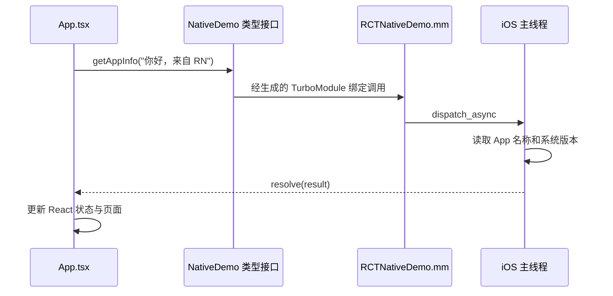
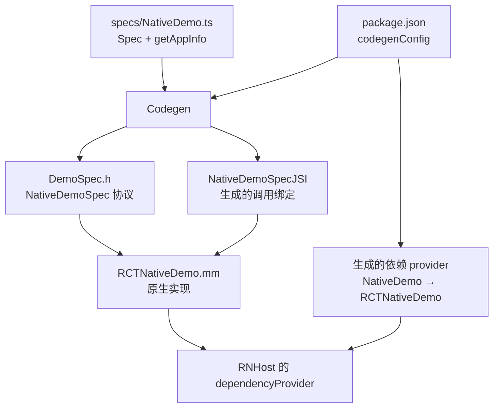
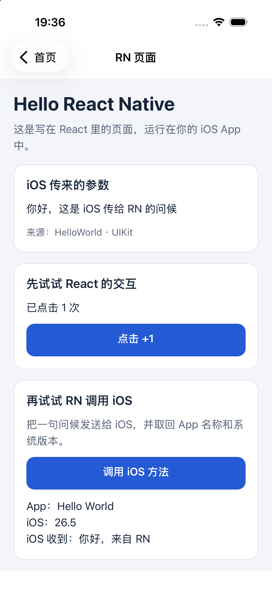

上一篇已经能在原生导航栈中打开 RN 页面。这一篇增加两条数据路径：iOS 创建页面时传入问候语；RN 点击按钮后调用原生方法，获取 App 名称、系统版本和原生收到的消息。

[系列源码压缩包]()的 `05-rn` 包含本文代码。运行方式仍为 `./setup.sh`、`./run.sh`，从首页进入 RN 页面，再点击“调用 iOS 方法”。本文继续使用锁定的 RN 0.88.1，实现的是该版本的 Turbo Native Module。

## 创建页面时的参数直接成为 props

原生控制器创建 RN 根视图时，已经传入一个字典：

```objc
NSDictionary *initialProperties = @{
    @"greeting": @"你好，这是 iOS 传给 RN 的问候",
    @"source": @"HelloWorld · UIKit"
};

UIView *reactView = [[RNHost sharedHost] viewWithModuleName:@"HelloRN"
                                      initialProperties:initialProperties];
```

RN 根组件通过同名 props 读取它：

```tsx
type AppProps = {
  greeting?: string;
  source?: string;
};

export default function App({
  greeting = '你好，React Native',
  source = 'iOS',
}: AppProps) {
  // 页面中通过 <Text>{greeting}</Text> 显示。
}
```

`initialProperties` 表达的是创建根视图时的初始数据。这份字典不会自动跟踪原生对象后续的变化。需要页面打开后持续接收变化时，应设计明确的更新或事件机制；本文的静态问候语不需要增加事件订阅。

跨运行环境的数据要有可转换的形式。字符串、数字、布尔值，以及由这些值组成的数组和字典，适合这个入口。`UIViewController`、函数闭包或任意业务对象不能直接当作 React props 传过去。

这条数据路径适合页面编号、展示模式和进入来源。

## RN 主动调用原生需要一个模块接口

`initialProperties` 无法表达“点击时向 iOS 发起一次操作并等待结果”。这里新增 `NativeDemo.getAppInfo(message)`，由 iOS 读取应用和设备信息，再返回 Promise 结果。



接口定义、生成代码和原生实现各有一份职责。TypeScript 声明跨端契约，Codegen 生成原生接口与绑定，Objective-C++ 实现系统能力。JavaScript 代码通过 RN 的模块注册表取得可调用的模块。

## 第一步：用 TypeScript 声明契约

创建 `specs/NativeDemo.ts`：

```ts
import type {TurboModule} from 'react-native';
import {TurboModuleRegistry} from 'react-native';

export type AppInfo = {
  appName: string;
  systemVersion: string;
  receivedMessage: string;
};

export interface Spec extends TurboModule {
  getAppInfo(message: string): Promise<AppInfo>;
}

export default TurboModuleRegistry.getEnforcing<Spec>('NativeDemo');
```

文件名使用 `Native` 前缀，让 Codegen 按 Native Module spec 识别。`Spec extends TurboModule` 声明模块接口；`Promise<AppInfo>` 指定异步结果的数据形状。

`getEnforcing('NativeDemo')` 按注册名获取模块。模块缺失时，它会抛错，适合本文这种必须随 App 一起编译的模块。这个调用发生在模块导入期间，早于按钮点击；原生模块完全没有注册时，按钮函数内部的 `try/catch` 无法拦截这次导入错误。

TypeScript 检查调用端的参数和使用方式，Codegen 用 spec 生成原生声明。它们不能代替业务输入验证。例如“空字符串是否允许”仍要由接口设计和实现约定。

## 第二步：配置 Codegen 与实现类的映射

`package.json` 增加以下配置，源码中已经写好：

```json
{
  "codegenConfig": {
    "name": "DemoSpec",
    "type": "modules",
    "jsSrcsDir": "specs",
    "ios": {
      "modulesProvider": {
        "NativeDemo": "RCTNativeDemo"
      }
    }
  }
}
```

`name` 指定生成接口集合的名称，后面通过 `<DemoSpec/DemoSpec.h>` 导入。`jsSrcsDir` 指定扫描目录，`type: modules` 表示生成原生模块相关代码。`modulesProvider` 把 JS 注册名 `NativeDemo` 映射到 Objective-C 类 `RCTNativeDemo`。



前一篇的 Podfile 已经调用 `use_react_native!`，安装过程会执行对应的代码生成流程。新增或修改 spec 后，执行 `./setup.sh`，再重新编译 App。生成的头文件和 provider 属于构建产物，不要直接修改。

如果只修改 JS 调用代码，Metro 可以重新加载。修改跨端接口以后，还需要生成与接口一致的原生代码。旧 App 中编译好的模块不会随着 TypeScript 文件刷新而自动改变。

## 第三步：实现生成的原生协议

`HelloWorld/RCTNativeDemo.h` 导入生成头文件，并声明实现协议：

```objc
#import <Foundation/Foundation.h>
#import <DemoSpec/DemoSpec.h>

@interface RCTNativeDemo : NSObject <NativeDemoSpec>
@end
```

`HelloWorld/RCTNativeDemo.mm` 提供完整实现：

```objc
#import "RCTNativeDemo.h"
#import <UIKit/UIKit.h>

@implementation RCTNativeDemo

RCT_EXPORT_MODULE(NativeDemo)

+ (BOOL)requiresMainQueueSetup {
    return NO;
}

- (void)getAppInfo:(NSString *)message
           resolve:(RCTPromiseResolveBlock)resolve
            reject:(RCTPromiseRejectBlock)reject {
    dispatch_async(dispatch_get_main_queue(), ^{
        NSString *appName = [[NSBundle mainBundle]
            objectForInfoDictionaryKey:@"CFBundleDisplayName"];
        NSDictionary *result = @{
            @"appName": appName ?: @"Hello World",
            @"systemVersion": [UIDevice currentDevice].systemVersion,
            @"receivedMessage": message
        };
        NSLog(@"[RN → iOS] NativeDemo.getAppInfo 收到：%@", message);
        resolve(result);
    });
}

- (std::shared_ptr<facebook::react::TurboModule>)getTurboModule:
    (const facebook::react::ObjCTurboModule::InitParams &)params {
    return std::make_shared<facebook::react::NativeDemoSpecJSI>(params);
}

@end
```

生成协议规定了 `getAppInfo:resolve:reject:` 的方法形态。JS 中一个返回 Promise 的方法，对应原生方法中的成功和失败回调。调用 `resolve(result)` 后，调用端的 `await` 得到这个字典转换的对象。

`RCT_EXPORT_MODULE(NativeDemo)` 对齐模块注册名，`modulesProvider` 对齐实现类名，`getTurboModule:` 提供生成的 JSI 绑定。这几项要和 spec 一起配置，不能只加一个导出宏就认为整个模块已经接好。

文件后缀必须为 `.mm`，因为 `std::shared_ptr`、`std::make_shared` 和命名空间属于 C++。在 Xcode 中创建文件后，还要确认 `RCTNativeDemo.mm` 属于 HelloWorld target 的 Compile Sources。下载代码已经保存这项工程配置，仅把文件复制到磁盘不能保证它进入编译。

`requiresMainQueueSetup` 表示模块初始化是否要求主线程。返回 `NO` 不承诺每个方法都在主线程执行。本文显式把读取 UIKit 相关信息的短操作放到主队列；实际模块操作 UI 时，也必须显式满足主线程要求。

耗时计算、文件处理或同步网络操作不应放在这段主队列 block 中。需要耗时工作时，应安排到合适的后台队列，再按 API 的线程要求处理结果和界面。

## 第四步：在页面中等待结果

页面维护结果、等待状态和错误状态。下面是 `App.tsx` 中与调用相关的代码，省略的是样式和其他卡片：

```tsx
import React, {useEffect, useRef, useState} from 'react';
import {Pressable, Text} from 'react-native';
import NativeDemo, {type AppInfo} from './specs/NativeDemo';

// 以下代码位于 App 组件内部。
const [appInfo, setAppInfo] = useState<AppInfo | null>(null);
const [loading, setLoading] = useState(false);
const [error, setError] = useState<string | null>(null);
const isMounted = useRef(false);

useEffect(() => {
  isMounted.current = true;
  return () => {
    isMounted.current = false;
  };
}, []);

async function requestAppInfo() {
  if (loading) return;
  setLoading(true);
  setError(null);
  try {
    const result = await NativeDemo.getAppInfo('你好，来自 RN');
    if (isMounted.current) setAppInfo(result);
  } catch (cause) {
    if (isMounted.current) {
      setError(cause instanceof Error ? cause.message : '调用 iOS 方法失败');
    }
  } finally {
    if (isMounted.current) setLoading(false);
  }
}

// JSX 中的调用入口和结果区：
<>
  <Pressable disabled={loading} onPress={requestAppInfo}>
    <Text>{loading ? '正在等待 iOS…' : '调用 iOS 方法'}</Text>
  </Pressable>
  {appInfo ? (
    <Text>{`App：${appInfo.appName}\niOS：${appInfo.systemVersion}\niOS 收到：${appInfo.receivedMessage}`}</Text>
  ) : null}
  {error ? <Text accessibilityRole="alert">{error}</Text> : null}
</>
```

等待期间禁用按钮，避免正常连续点击重复发起调用。`catch` 展示原生方法拒绝 Promise 或调用过程中抛出的错误，`finally` 清理等待状态。这里的原生实现只读取系统信息，正常路径使用 `resolve`；`reject` 参数保留了接口的失败返回能力。

用户可能在异步返回之前点击原生导航栏的返回。RN 组件卸载后，`isMounted` 变为 `false`，后续结果不再写入这个页面。它只约束 JS 的状态写入，不会取消已经开始的原生任务；录音、定位或长时间请求需要额外设计停止和取消接口。


{: width="380" }
_2026 年 11 月 2 日保存的 Release 模拟器截图：上方保留 UIKit 导航栏，下方 RN 内容显示 iOS 传参及原生方法返回值。截图中的系统版本属于当时的模拟器。_

## 名字和类型在哪些位置对应

这个例子有三个相似的名字。`NativeDemo` 是 JS 查找模块时使用的注册名；`RCTNativeDemo` 是原生实现类名；`DemoSpec` 是生成接口集合的名称。它们可以按规则分别命名，但引用关系必须准确。

| 关系 | 本文的对应值 |
| --- | --- |
| JS 查询名与导出模块名 | `NativeDemo` |
| provider 映射的实现类 | `RCTNativeDemo` |
| 生成接口集合与导入路径 | `DemoSpec`、`DemoSpec/DemoSpec.h` |
| 原生遵守的生成协议 | `NativeDemoSpec` |
| 原生返回的生成绑定 | `NativeDemoSpecJSI` |

`getAppInfo` 在 JS 中只有一个业务参数。原生方法的 `resolve` 和 `reject` 是 Promise 结果通道，不需要在 JS 侧额外传入两个回调。Objective-C 选择子中的冒号数量对应原生方法参数，不能照着 JS 参数数目手写一份不符合生成协议的方法。

返回字典的键要与 `AppInfo` 一致。这里明确返回三个字符串，所以 JS 可以直接渲染它们。`NSDictionary` 不能把 `nil` 当作值，代码用 `appName ?: @"Hello World"` 为应用名提供兜底。如果业务允许缺失字段，要在接口类型和原生返回规则中一起表达。

接口升级也需要两端同步。例如把 `receivedMessage` 改名后，修改 spec、原生结果和调用端，再执行代码生成与原生构建。仅修改调用端类型断言，会让编辑器暂时不报错，却不会改变设备上实际返回的数据。

## 把原生能力与页面展示分开

这个模块返回原生读取到的信息，页面自行决定如何展示。以后同一个方法可以用于卡片、设置页或日志页面，不需要让原生实现知道这些页面的布局。接口围绕需要的能力定义，页面文案与样式继续放在 React 组件中。

Promise 适合“一次请求，一次最终结果”。开始录音后不断返回音量、监听设备状态或连续接收定位，需要多次通知，不能靠对同一个 Promise 反复 `resolve` 实现。那类接口需要单独的事件或流设计，并约定开始、停止和订阅释放。

错误也需要契约。验证失败时可以使用稳定的错误码，让 JS 决定是否提示、重试或跳转；详细系统错误可以作为诊断信息保存。本文的 `E_EMPTY_MESSAGE` 实验用于观察错误路径，没有设计跨业务的错误分类系统。

调用顺利返回只验证了这一条参数与结果路径。真正的系统能力还要处理权限、不可用状态和取消等分支，相关返回规则应随着具体能力加入接口。把所有异常都转换为空字符串，会让页面分不清“没有数据”和“操作失败”。

## 错误路径也要有可观察的行为

可以临时在原生方法开头加入输入验证，检查 Promise 拒绝如何到达页面：

```objc
if (message.length == 0) {
    reject(@"E_EMPTY_MESSAGE", @"message 不能为空", nil);
    return;
}
```

然后把 JS 调用参数临时改成空字符串，重新编译运行。页面应进入错误展示分支。这个片段是错误实验的改动，下载代码的正常调用传入非空问候语。`return` 防止拒绝后继续执行成功分支；一次操作应以成功或失败结束。

检查卸载保护时，可以临时把原生的 `dispatch_async` 改成延后一秒派发：

```objc
dispatch_after(dispatch_time(DISPATCH_TIME_NOW, (int64_t)(1 * NSEC_PER_SEC)),
               dispatch_get_main_queue(), ^{
    // 原有的读取信息和 resolve(result) 放在这里。
});
```

延后派发期间主线程可以继续处理导航操作。点击调用后立即返回首页，检查异步结果是否仍向已卸载页面写入。实验结束后恢复正常派发；人为延迟不能作为跨端调用耗时。

如果编译时找不到 `DemoSpec/DemoSpec.h`，检查 spec 路径、`codegenConfig.name`、Pods 安装输出和 workspace 入口。头文件属于生成接口，重启 Metro 无法生成缺失的原生工程文件。

如果运行时提示找不到 `NativeDemo`，核对 JS 注册名、导出宏、`modulesProvider` 的类名，以及 `.mm` 是否参与 target 编译，再重新安装 App。只刷新 JS 无法增加原生二进制里缺失的实现。

如果 Promise 一直等待，检查原生路径是否调用了 `resolve` 或 `reject`，以及是否有队列阻塞。按钮保持 loading 能暴露“结果没有回来”，不能自动修复未结束的原生操作。

参考：[Turbo Native Modules 入门](https://reactnative.dev/docs/turbo-native-modules-introduction)。本文把动态事件订阅留在示例范围之外；多次返回的数据流需要事件契约、订阅清理和明确的资源释放方式。

上一篇：[把 RN 页面放进 iOS App]()。下一篇：[JavaScript 从源码到 App 内置 bundle]()。
