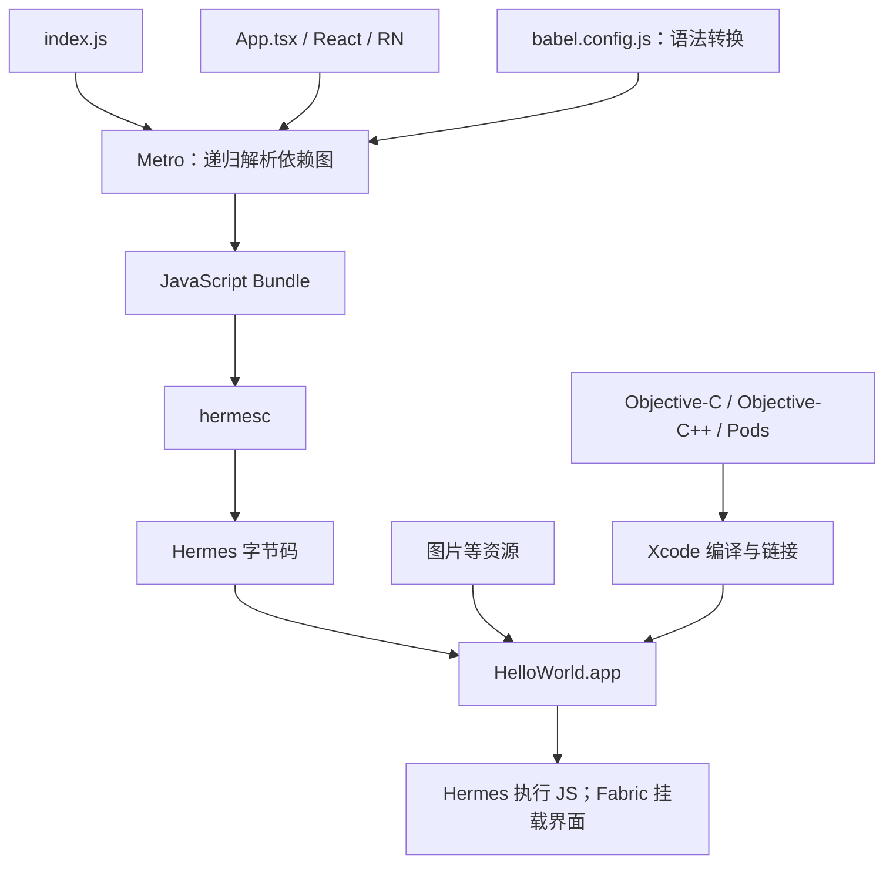

RN 页面需要 JavaScript，安装到手机上的 App 又需要能独立启动。这两件事通过打包阶段连接：Metro 把入口及依赖转换成 Bundle，Xcode 把运行所需的产物放进 App。

本文使用[系列示例源码]()中的 `05-rn` 阶段。版本固定为 RN 0.88.1、React 19.3.0，原生运行环境启用 Hermes。开发服务使用 8082 端口。

## 四种文件分别由谁处理

| 输入 | 处理者 | 产物或用途 |
| --- | --- | --- |
| `App.tsx`、依赖中的 JS | Metro 调用转换器，使用 Babel 配置 | 可供运行时执行的 JavaScript Bundle |
| JavaScript Bundle | 与 RN 匹配的 `hermesc` | Hermes 字节码 |
| `.m`、`.mm`、原生依赖 | Xcode 的编译和链接工具 | App 可执行文件和原生库 |
| Bundle、图片、原生可执行文件 | Xcode 构建阶段 | `.app` 目录中的安装内容 |

`App.tsx` 中的 TypeScript 类型会在转换时被去掉。Metro 打包成功不能代替类型检查，`npm run typecheck` 仍需单独执行。

原生代码编译和 JS 打包属于两条处理链。修改 `RCTNativeDemo.mm` 需要重新编译 App；修改 `App.tsx` 可以由开发中的 Metro 提供新内容。使用内置 Bundle 时，修改 JS 也需要重新生成安装产物。



Metro 从 `index.js` 出发，沿 `import` 和 `require` 找到所需模块，再处理平台文件、语法转换、模块封装和资源引用。入口决定依赖图的起点；`AppRegistry` 注册名决定运行时创建哪个根组件。

## 开发模式：向 Metro 取 JS

在 `05-rn` 目录执行：

```bash
./setup.sh
./run.sh --metro
```

脚本启动或复用属于本目录的 Metro，再以环境变量 `RN_USE_METRO=1` 启动 Debug App。`RNHost` 在这个条件下返回开发服务 URL：

```objc
#if DEBUG
if ([[NSProcessInfo processInfo].environment[@"RN_USE_METRO"]
        isEqualToString:@"1"]) {
    return [RCTBundleURLProvider
        jsBundleURLForBundleRoot:@"index"
        packagerHost:@"localhost:8082"
        enableDev:YES
        enableMinification:NO
        inlineSourceMap:NO];
}
#endif
```

模拟器的 `localhost` 指向这台 Mac 提供的服务。真机的 `localhost` 指向手机自身，真机调试需要另设电脑的局域网地址。

修改 React 组件后，Fast Refresh 将改动送入正在运行的 App。在符合保留状态条件时，计数器等局部状态可以保留；修改模块导出形式或组件结构也可能触发重新挂载。原生代码、Codegen 接口和编译配置的变化仍需要重新构建。

在 Xcode 中运行时，可以在 **Product → Scheme → Edit Scheme → Run → Arguments** 添加 `RN_USE_METRO=1`，并在终端执行 `npm start`。Xcode Scheme 环境变量与终端启动的进程环境各自生效，脚本设置的值不会自动写回 Scheme。

## 离线 Debug：把 JS 放进 App

示例默认执行 `./run.sh` 时也会生成内置 Bundle。这个选择使首次打开 RN 页面不依赖开发服务。

RN 的标准 Xcode 脚本通常跳过模拟器 Debug 的打包步骤。本项目显式设置了 `FORCE_BUNDLING=1`：

```bash
set -e
export PROJECT_ROOT="$PROJECT_DIR"
export FORCE_BUNDLING=1
export RCT_METRO_PORT=8082

WITH_ENVIRONMENT="$PROJECT_DIR/node_modules/react-native/scripts/xcode/with-environment.sh"
REACT_NATIVE_XCODE="$PROJECT_DIR/node_modules/react-native/scripts/react-native-xcode.sh"

ENTRY_FILE=index.js BUNDLE_NAME=main /bin/sh -c \
  "\"$WITH_ENVIRONMENT\" \"$REACT_NATIVE_XCODE\""
```

这段脚本位于 App Target 的 **Build Phases → Bundle React Native code and images**。工程与 `package.json` 在同一目录，因此 `PROJECT_ROOT` 指向 `$PROJECT_DIR`。套用 `ios/` 子目录工程的默认相对路径，会使 Metro 找错项目根目录。

`with-environment.sh` 读取 `.xcode.env` 和本机的 `.xcode.env.local`，找到 `NODE_BINARY`；后面的脚本调用 Metro，并在启用 Hermes 时执行字节码编译。`setup.sh` 会生成本机 Node 路径，更换 Node 安装位置后应重新执行。

离线分支通过 `NSBundle` 取出安装内容：

```objc
return [[NSBundle mainBundle] URLForResource:@"main"
                              withExtension:@"jsbundle"];
```

Debug 仍包含开发检查。使用内置 Bundle 只改变 JS 来源，不能把它等同于生产构建。

## Release：检查最终安装产物

```bash
./run.sh --release
```

示例的 Release 始终使用内置 Bundle。`#if DEBUG` 内的 Metro 分支不参与这次编译，外部设置 `RN_USE_METRO=1` 也不会使它连接开发服务。

查看生成的安装目录：

```bash
APP=build/DerivedData/Build/Products/Release-iphonesimulator/HelloWorld.app
ls -lh "$APP/main.jsbundle"
file "$APP/main.jsbundle"
```

在当前 Hermes 构建中，App 内名为 `main.jsbundle` 的文件可以是字节码。**扩展名不能证明内容格式。** Metro 刚生成的源码 Bundle 和最终复制进 App 的 Hermes 产物，也可能位于不同目录。

Hermes 的编译器和运行时需要匹配。示例交给 RN 的 Xcode 脚本选择 Pods 中的编译器；随意用另一套 `hermesc` 重新编译，可能产生运行时无法识别的字节码版本。

Release 离线检查可以分成三个动作：退出之前的 App、停止属于本项目的 Metro、重新启动 Release App。RN 页面、计数器和 `NativeDemo.getAppInfo` 都应继续工作。只检查“编译成功”无法证明包中包含正确入口和所需资源。

## 单独生成一份源码 Bundle

分析体积时，可以单独运行 Metro：

```bash
mkdir -p build/inspect
npx react-native bundle \
  --platform ios \
  --dev false \
  --entry-file index.js \
  --bundle-output build/inspect/main.jsbundle \
  --assets-dest build/inspect/assets \
  --sourcemap-output build/inspect/main.jsbundle.map

wc -c build/inspect/main.jsbundle
```

这条命令输出 JavaScript 源码 Bundle，并不自动完成 Xcode 脚本里的 Hermes 编译。它适合观察模块组成、比较拆分前后的同类产物。它的体积不能直接与 App 内的字节码相比。

Source Map 负责把打包后的位置映射回源文件。经过 Hermes 编译后，还存在字节码位置到打包 JS 的映射；生产堆栈符号化需要与实际发布产物匹配的组合映射。示例默认不公开发布 Source Map。文件名相同、构建时间接近，都不足以证明映射与线上包匹配。

## 根据出错阶段排查

| 现象 | 检查位置 | 可验证的事实 |
| --- | --- | --- |
| Xcode 报 Node 不存在 | `.xcode.env.local`、脚本日志 | 路径存在且可执行 |
| Metro 找不到入口 | `ENTRY_FILE`、`PROJECT_ROOT` | 入口相对项目根目录可解析 |
| 模拟器连不上 Metro | 模式变量、8082 端口 | 服务来自本项目，URL 对应 `index` |
| 离线提示 Bundle URL 为空 | `.app` 内的文件、`bundleURL` | `main.jsbundle` 存在，名字相符 |
| JS 代码改了，离线页面没变 | 安装的构建和打包日志 | 新 Bundle 已写入并重新安装 |
| 根组件没有注册 | `index.js` 与原生 moduleName | 都使用 `HelloRN`，入口成功执行 |
| 字节码版本错误 | `hermesc` 与 Hermes 依赖 | 编译器来自当前 RN/Pods 依赖集合 |

清缓存应当对应具体证据。入口写错、原生注册名不匹配、打包脚本没运行，都不会通过反复删除 DerivedData 自动修复。

## 下一篇的拆分单位

一个完整 Bundle 包含入口需要的全部依赖。两个入口分别执行上述打包命令，通常会各自带上 React 和 RN 的 JS 模块。下一篇先实现这种可独立加载的多入口结构，第九篇再用模块清单验证重复依赖如何被移出业务包。

参考：[Metro 的工作过程](https://metrobundler.dev/docs/concepts/)、[React Native 使用 Hermes](https://reactnative.dev/docs/hermes)、[RN Xcode 打包脚本](https://github.com/facebook/react-native/blob/v0.88.1/packages/react-native/scripts/react-native-xcode.sh)。

上一篇：[原生与 RN 的双向通信]() · 下一篇：[多入口与独立 Bundle]()
