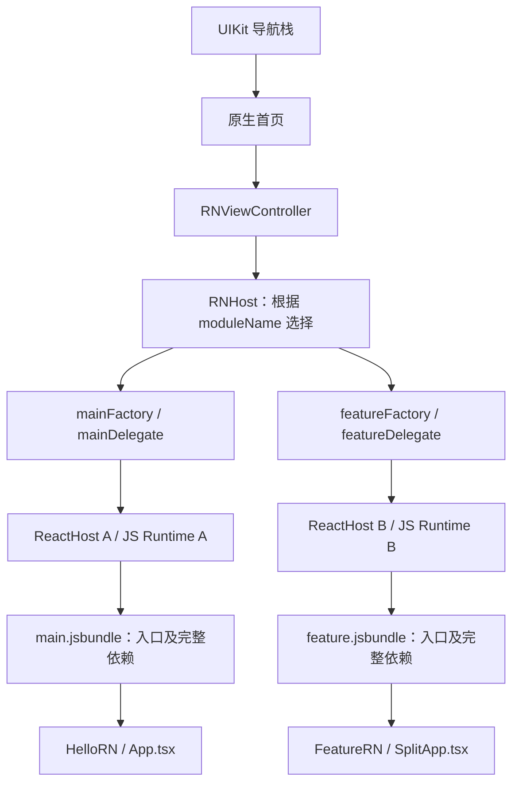

前七篇只有一个 RN 入口。新增业务页面时，可以继续注册在同一份 Bundle 中，也可以从另一个入口构建独立 Bundle。本篇选择后者：原生首页分别打开 `HelloRN` 和 `FeatureRN`，两者各自使用一份完整 Bundle。

[示例源码]()的 `08-multiple` 包含完整工程。代码使用 RN 0.88.1 的 Factory 接入方式；沿用第七篇的 Debug 内置、Metro 和 Release 三种运行模式。

## 一个入口与一份运行环境

第二个入口包含独立的页面组件和注册名：

```js
// split-entry.js
import {AppRegistry} from 'react-native';
import SplitApp from './SplitApp';

AppRegistry.registerComponent('FeatureRN', () => SplitApp);
```

```tsx
// SplitApp.tsx：省略样式
import React, {useState} from 'react';
import {Pressable, Text, View} from 'react-native';

export default function SplitApp({featureName = '拆包业务页'}) {
  const [count, setCount] = useState(0);
  return (
    <View>
      <Text>{featureName}</Text>
      <Pressable onPress={() => setCount(value => value + 1)}>
        <Text>拆包页按钮：{count}</Text>
      </Pressable>
    </View>
  );
}
```

`split-entry.js` 是打包入口，`FeatureRN` 是根组件注册名，`feature.jsbundle` 是输出文件名。这三个名字可以不同；需要分别在构建脚本、原生路由和 JS 注册处保持对应关系。

| 原生请求 | Factory | 入口文件 | 内置文件 | 注册组件 |
| --- | --- | --- | --- | --- |
| 打开 RN 页面 | `mainFactory` | `index.js` | `main.jsbundle` | `HelloRN` |
| 打开拆包 RN 页面 | `featureFactory` | `split-entry.js` | `feature.jsbundle` | `FeatureRN` |

入口文件名省略扩展名后，也是本例访问 Metro 时的 `bundlePath`。把 `FeatureRN` 填进 `bundlePath`，Metro 会尝试寻找同名入口，而不会替原生查询 AppRegistry。

## 为什么使用两个 Factory

运行环境的复用由第五篇的 `RNHost` 负责。同一 Factory 的 `rootViewFactory` 在第一次创建视图时建立并保留 ReactHost，后续视图使用这份 Host。给下一次视图创建传入另一个 Bundle 配置，不等于把已运行的 Host 换成第二份 Bundle。

本例为两个独立 Bundle 分别保留 Factory 和 Delegate。每份 Bundle 都能单独初始化一个 RN 运行环境：



图中每份 Runtime 都有自己的 JS 全局对象、模块缓存和 React 状态。原生可执行文件仍由同一个 App 安装包提供，不会因为多一个 JS Bundle 就复制两份 UIKit 或 RN 原生二进制。

两个页面如果只是同一业务应用中的不同路由，注册在一份 Bundle、复用一个 Factory 通常更直接。这里使用独立运行环境，是为了观察“原生怎样选择一份代码”，并为下一篇的共享运行环境建立对照。

## Delegate 把入口和文件绑定起来

`DemoReactNativeDelegate` 增加两个属性：

```objc
@interface DemoReactNativeDelegate : RCTDefaultReactNativeFactoryDelegate
@property (nonatomic, copy) NSString *entryFile;
@property (nonatomic, copy) NSString *bundleName;
@end
```

`entryFile` 记录 Metro 入口，`bundleName` 记录内置文件名。两个加载分支仍然采用第七篇的方法：

```objc
- (NSURL *)bundleURL {
#if DEBUG
    if ([[NSProcessInfo processInfo].environment[@"RN_USE_METRO"]
            isEqualToString:@"1"]) {
        return [RCTBundleURLProvider
            jsBundleURLForBundleRoot:self.entryFile
            packagerHost:@"localhost:8082"
            enableDev:YES
            enableMinification:NO
            inlineSourceMap:NO];
    }
#endif
    return [[NSBundle mainBundle] URLForResource:self.bundleName
                                  withExtension:@"jsbundle"];
}
```

`RNHost` 初始化时分别建立两组对象：

```objc
_mainDelegate = [[DemoReactNativeDelegate alloc]
    initWithEntryFile:@"index" bundleName:@"main"];
_featureDelegate = [[DemoReactNativeDelegate alloc]
    initWithEntryFile:@"split-entry" bundleName:@"feature"];

_mainDelegate.dependencyProvider = [[RCTAppDependencyProvider alloc] init];
_featureDelegate.dependencyProvider = [[RCTAppDependencyProvider alloc] init];

_mainFactory = [[RCTReactNativeFactory alloc] initWithDelegate:_mainDelegate];
_featureFactory = [[RCTReactNativeFactory alloc] initWithDelegate:_featureDelegate];
```

这些 ivar 对应类扩展中的 `strong` 属性。两组 Bundle 配置、开发菜单配置也分别保存。完整实现见源码 `HelloWorld/RNHost.mm`。

创建视图时，从同一组中选择 Factory 和配置：

```objc
BOOL isFeature = [moduleName isEqualToString:@"FeatureRN"];
RCTReactNativeFactory *factory =
    isFeature ? self.featureFactory : self.mainFactory;
RCTBundleConfiguration *bundleConfiguration =
    isFeature ? self.featureBundleConfiguration : self.mainBundleConfiguration;
RCTDevMenuConfiguration *devMenuConfiguration =
    isFeature ? self.featureDevMenuConfiguration : self.mainDevMenuConfiguration;

return [factory.rootViewFactory viewWithModuleName:moduleName
    initialProperties:initialProperties
    launchOptions:nil
    bundleConfiguration:bundleConfiguration
    devMenuConfiguration:devMenuConfiguration];
```

这是针对两个固定入口的教学路由。业务入口增加后，可以把 moduleName、入口、文件、Factory 收进明确的配置表，并对未知路由报错。示例中的二选一判断不适合直接扩展成任意字符串的默认兜底。

## 原生页面只增加路由参数

`RNViewController` 保存根组件名和导航标题。首页的第二个 RN 按钮创建容器时指定 `FeatureRN`：

```objc
- (void)openSplitRNPage {
    RNViewController *page = [[RNViewController alloc]
        initWithModuleName:@"FeatureRN" title:@"拆包 RN 页面"];
    [self.navigationController pushViewController:page animated:YES];
}
```

容器根据组件名准备不同的初始参数。`HelloRN` 接收 `greeting`、`source`，`FeatureRN` 接收 `featureName`。它们仍通过 `initialProperties` 进入各自的 React 根组件。

原生返回按钮沿用导航控制器。Factory 保持存活与页面保持存活是两个问题：退出容器后，下一次进入会创建新的根视图。组件局部计数可以重新开始，Runtime 中已经初始化的模块则可能继续存在。

## 构建两份完整 Bundle

构建阶段连续调用两次 RN 提供的打包脚本：

```bash
ENTRY_FILE=index.js BUNDLE_NAME=main /bin/sh -c \
  "\"$WITH_ENVIRONMENT\" \"$REACT_NATIVE_XCODE\""

ENTRY_FILE=split-entry.js BUNDLE_NAME=feature /bin/sh -c \
  "\"$WITH_ENVIRONMENT\" \"$REACT_NATIVE_XCODE\""
```

第二次设置不同的 `BUNDLE_NAME`，避免覆盖第一次产物。两次沿用相同的构建模式、平台和依赖版本，并把图片等资源复制到 App 的资源目录。

运行步骤：

```bash
cd 08-multiple
./setup.sh
./run.sh
# 前端开发模式：./run.sh --metro
# 生产包模式：./run.sh --release
```

在默认模式下，两个 RN 按钮应打开各自页面。Metro 模式会分别请求 `index` 和 `split-entry`。先打开其中一个页面、返回，再打开另一个页面，可以检查是否错误复用了首次选择的入口。

Release 构建后检查安装目录：

```bash
APP=build/DerivedData/Build/Products/Release-iphonesimulator/HelloWorld.app
ls -lh "$APP/main.jsbundle" "$APP/feature.jsbundle"
```

2026 年 11 月 18 日，示例多入口工程在 Xcode 27.2 下通过了 Debug 模拟器编译。编译检查只覆盖生成安装产物；运行本节步骤时，还应验证两个入口、返回和再次进入。

## 独立 Bundle 的成本

两个入口都会导入 React 和 React Native。Metro 分别遍历入口依赖图，因此两个完整 Bundle 各自包含运行所需的 JS 模块。业务页面很短，也可能生成很大的独立 Bundle。

| 维度 | 本例结构的行为 |
| --- | --- |
| JS 代码体积 | 完整 Bundle 中存在重复依赖 |
| JS 模块状态 | 分属两份 Runtime，不能直接共用模块单例 |
| 内存 | 两份运行环境各有模块缓存等开销，具体数值需要实测 |
| 原生模块 | 仍需审查多 Host 下的实例、线程、事件订阅和进程级单例 |
| 业务隔离 | 入口可以独立加载，但仍受同一 App 的 RN 原生版本约束 |
| 发布 | 本例随 App 内置，不包含网络下载、热更新或回滚系统 |

把第二个入口移进主包的模块图，也是一种减少重复的办法。是否需要独立包，应由业务加载边界和发布需求决定。公共包拆分还会引入额外的构建与加载约束。

## 下一步需要共享什么

若希望两份业务复用 React、RN JS 和公共模块，需要让业务包引用同一份公共模块表，并在同一个 Runtime 中执行。给两个独立 Factory 各加载半份代码，无法共享它们的 `globalThis` 和 Metro 缓存。

下一篇用真正的 Metro 构建产物比较“两个完整包”和“一个公共包＋两个业务增量包”。它同时标出 RN 0.88 原生追加加载接口的边界，区分已验证的构建结果与仍需适配的 iOS 加载器。

参考：[RCTRootViewFactory 实现](https://github.com/facebook/react-native/blob/v0.88.1/packages/react-native/Libraries/AppDelegate/RCTRootViewFactory.mm)、[Metro Serializer 配置](https://metrobundler.dev/docs/configuration/#serializer-options)。

上一篇：[Metro、Hermes 与离线运行]() · 下一篇：[公共包与业务包]()
