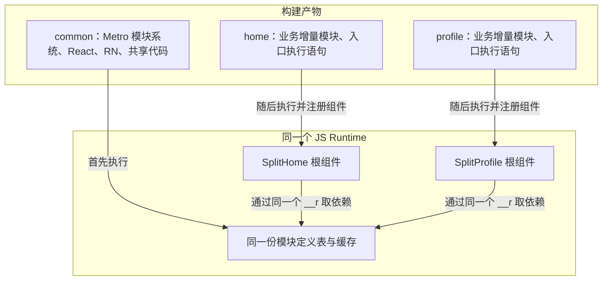

[上一篇]()按业务入口生成了多个完整 Bundle。每份包都能携带自己的依赖，React、RN 和公共代码也随之重复。业务越来越多时，可以把这些公共模块提取为一份 `common`，让业务包引用它们。

本文使用[系列示例源码]()中的 `09-shared`。它完成真实 Metro 构建和 Node VM 模块加载验证，**没有实现 iOS 新架构中的追加包加载器**。文中的体积数字来自构建产物，不包含 iOS 页面运行或启动性能结论。

## 从两份完整包到一份公共包

完整 Bundle 大致包含三部分：Metro 的模块加载代码、用 `__d` 注册的模块定义，以及执行入口的启动语句。拆包需要分别处理这三部分。



业务包里的 `require` 最终要找到公共包注册的模块。**两个包必须进入同一个 Runtime，并共用同一份 Metro 模块表。** 把 common 放进一个 Factory，再把 home 放进另一个独立 Factory，无法建立这份共享关系。

对于前端开发，模块表类似打包器在浏览器里维护的模块缓存。iOS 多了一层原生宿主：它还负责创建 JS 引擎、安装原生绑定，以及决定代码何时进入引擎。

## 公共入口决定公共依赖图

`entries/common.js` 显式选择要共享的模块：

```javascript
const React = require('react');
const {AppRegistry} = require('react-native');
const shared = require('./shared');

globalThis.__splitCommonReady = {
  reactVersion: React.version,
  shared,
  AppRegistry,
};
```

Metro 从这些入口依赖递归构建模块图。公共包必须包含所选模块依赖的其他模块，形成完整的依赖闭包。例如公共工具依赖日期库，日期库也需要跟随它进入公共图。

本例没有自动计算多个业务图的交集。公共入口由开发者指定，再由 Metro 解析其完整依赖。业务入口各自构图，输出时扣除公共图已经包含的模块；业务独有依赖继续保留。

`entries/home.js` 仍然按普通 RN 页面编写：

```javascript
const React = require('react');
const {AppRegistry, View, Text} = require('react-native');
const shared = require('./shared');

function Home() {
  return React.createElement(
    View,
    {style: {flex: 1, alignItems: 'center', justifyContent: 'center'}},
    React.createElement(Text, null, shared.greeting('shared RN home')),
  );
}

AppRegistry.registerComponent('SplitHome', () => Home);
```

公共入口装入依赖，业务入口注册根组件。`SplitHome` 是交给原生创建根视图时使用的注册名；文件名、包名与注册名分别承担不同职责。

## 模块 ID 必须在所有包里一致

Metro 用模块 ID 表示依赖。以下是便于说明的简化产物，数字不对应本例实际 ID：

```javascript
// common：定义共享模块，暂不一定执行其工厂。
__d(function (global, require, importDefault, importAll, module) {
  module.exports = {greeting: name => `Hello ${name}`};
}, 100, []);

// home：依赖表里的 100 必须指向 common 中的同一模块。
__d(function (global, require, importDefault, importAll, module, exports, deps) {
  const shared = require(deps[0]);
  console.log(shared.greeting('home'));
}, 200, [100]);

__r(200);
```

如果两个独立构建按访问顺序各自分配 ID，`100` 可能在另一份包中代表不同文件。稳定映射需要把“同一个模块路径”转换成“同一个 ID”，并让所有产物使用相同规则。

构建脚本通过 `createModuleIdFactory` 提供映射。它先将机器上的绝对路径转换为项目内的逻辑路径，再计算整数 ID：

```javascript
const logical = file.startsWith(DEMO + '/')
  ? 'demo/' + path.relative(DEMO, file)
  : 'experiment/' + path.relative(ROOT, file);

const id = crypto.createHash('sha256')
  .update(logical)
  .digest()
  .readUInt32BE(0);
```

相对路径使解压位置变化时仍能得到相同映射。完整脚本还检查 ID 碰撞，并输出 `dist/module-ids.json`。32 位哈希存在碰撞可能，碰撞时构建会直接失败；生产系统需要明确的分配和兼容策略，不能只依赖“看起来不会重复”。

路径规则稳定也不等于版本兼容。同一路径的代码升级后，导出和依赖都可能改变，旧业务包仍可能与新 common 不匹配。

## 过滤模块，同时保留业务入口

`processModuleFilter` 控制模块是否写入产物。脚本先构建 common，记录它包含的路径，再切换到业务阶段：

```javascript
processModuleFilter: module => {
  if (phase === 'common') {
    commonPaths.add(module.path);
    return true;
  }
  return !commonPaths.has(module.path);
},
```

这一步过滤的是序列化输出。Metro 仍然解析业务图、转换依赖，才知道哪些模块和 ID 被引用，因此不能按包体减少比例推断构建时间收益。

业务包还要去掉重复的模块系统与启动代码：

```javascript
serializer: {
  createModuleIdFactory: () => moduleId,
  getModulesRunBeforeMainModule: () => phase === 'common'
    ? [requireDemo.resolve('react-native/setup-env')]
    : [],
  // processModuleFilter 等配置省略。
}

// 调用 server.build 时：
{
  platform: 'ios',
  dev: false,
  minify: true,
  modulesOnly: true, // 业务包不重复输出 prelude/polyfills。
  runModule: true,  // 仍然执行自己的入口。
}
```

RN 0.88.1 配套配置中的默认启动模块是 `react-native/setup-env`。common 保留它；业务包的启动前模块列表为空。`modulesOnly` 和 `runModule` 是两个独立选项：前者去掉前置脚本，后者决定是否生成入口执行语句。

[Metro 的序列化实现](https://github.com/react/metro/blob/v0.87.2/packages/metro/src/DeltaBundler/Serializers/baseJSBundle.js)中，`modulesOnly` 会清空 `preModules`；入口执行代码另行生成。因此，仅打开 `modulesOnly` 不会自动处理所有启动语句。

完整脚本使用 `Metro.runMetro` 创建 Server，再调用 `server.build`，从 `metro/private/Server` 获取默认选项。`Metro.runBuild` 没有直接透传本例需要的 `modulesOnly`。这些构建接口与 Metro 版本有关，升级依赖时需要重新核对。

## 运行构建与加载验证

这次测量使用 Node 22.22.0、React 19.3.0、RN 0.88.1、Metro 0.87.2。解压后的目录关系如下：

```text
ios-rn-series-demo/
├── 08-multiple/        # 提供已安装的 node_modules
└── 09-shared/
    ├── entries/        # common、home、profile、shared、smoke
    ├── scripts/build-shared-bundles.cjs
    ├── babel.config.js
    └── README.md
```

从解压后的示例根目录执行：

```bash
cd 08-multiple
npm ci
cd ../09-shared
node scripts/build-shared-bundles.cjs
cat dist/stats.json
```

`09-shared` 无需再装一套依赖。脚本与 Babel 默认从 `../08-multiple/node_modules` 解析所需包。已有其他同版本 RN 工程时，也可以显式指定：

```bash
RN_DEMO_ROOT=/absolute/path/to/installed-rn-project \
  node scripts/build-shared-bundles.cjs
```

脚本生成公共包、两个业务增量包、两个完整对照包，以及验证入口 `smoke.ios.jsbundle`。验证入口只引用 `shared.js`，避免将原生 UI 初始化混入模块加载测试。

共享模块为工厂执行次数和导出对象提供观察点：

```javascript
const loads = (globalThis.__sharedFactoryLoads || 0) + 1;
globalThis.__sharedFactoryLoads = loads;
module.exports = {
  identity: {},
  greeting: name => `Hello ${name}`,
  loads,
};
```

`__d` 注册模块工厂，`__r` 在需要时执行它，并缓存导出。脚本在同一个 Node `vm` context 中运行真实 Metro 产物，验证以下结果：

- 未装入 common 时，增量包因缺少 `__d` 而失败。
- 装入 common 模块定义后，smoke 得到 `Hello Metro`。
- 装载业务包前后的 `__r` 是同一个函数。
- 重复装载 smoke 后，共享工厂只执行一次，导出对象保持同一引用。
- 业务输出未重复包含公共模块。

**VM 验证跳过了 common 末尾的 RN 启动语句。** Node 不具备 iOS TurboModule、Fabric 和 Hermes 环境。这里验证了 Metro 的模块定义、ID 引用和缓存语义；home、profile 的原生渲染没有在本实验中验证。

## 实际减少了多少源码

所有产物使用相同 ID 规则，构建参数为 `platform=ios`、`dev=false`、`minify=true`。连续构建得到相同结果：

| 产物 | 原始字节数 | 模块定义数 |
| --- | ---: | ---: |
| `common.ios.jsbundle` | 892630 | 515 |
| `home.ios.jsbundle` | 376 | 1 |
| `profile.ios.jsbundle` | 379 | 1 |
| `home.full.ios.jsbundle` | 892766 | 515 |
| `profile.full.ios.jsbundle` | 892769 | 515 |

两份完整包合计 **1785535 B**。common 加两个业务增量包合计 **893385 B**，该示例减少 **49.97%**。

两个页面几乎只有文案不同，公共代码占比很高，所以业务增量包只有几百字节。真实业务包含更多组件、状态和独有依赖，收益需要重新测量。这些数字只表示经过 minify、未做 gzip/Brotli 传输压缩的 JavaScript 源码 Bundle 大小，不代表 Hermes 字节码、网络压缩大小、IPA、运行内存或首屏时间。

## iOS 还需要一层加载适配

构建完成后，原生宿主要按顺序把代码交给同一个 JS 引擎：公共包执行成功，再装载业务包，待业务注册组件完成后创建对应 surface。任何一步失败，都需要能定位和回退。

RN 0.88.1 的 [RCTHost 公共声明](https://github.com/react/react-native/blob/v0.88.1/packages/react-native/ReactCommon/react/runtime/platform/ios/ReactCommon/RCTHost.h)提供启动、创建 surface、调用 JS 模块等能力，没有完整的“启动后追加 Bundle 并通知评估完成”业务接口。

名字相近的 `loadBundleAtURL:onProgress:onComplete:` 属于 Host delegate 的源码加载回调。默认实现使用 `RCTJavaScriptLoader` 读取主包数据；下载或读取完成，不能直接等同于第二个包在既有 Runtime 中执行完成。

公开的 `host:didInitializeRuntime:` 钩子会在 JS 线程上交出 `jsi::Runtime&`。此时 TurboModule 和 NativeComponentRegistry 绑定已经安装，主包尚未执行。它提供定制运行时能力的连接点，不能把拿到的 Runtime 引用交给任意线程调用。

源码中的内部路径则能执行额外代码：`RCTHost+Internal.h` 声明的 `registerSegmentWithId:path:` 最终进入 [ReactInstance::registerSegment](https://github.com/react/react-native/blob/v0.88.1/packages/react-native/ReactCommon/react/runtime/ReactInstance.cpp)，经调度调用 `runtime.evaluateJavaScript`。这说明同一个 Runtime 具备评估后续代码的底层能力，但该 Host 入口属于 Internal，也没有给业务提供完整的完成与错误契约。

本例没有接入这些原生路径。落地时需要针对固定 RN 版本设计适配层，处理 Runtime 生命周期、JS 线程调度、装载去重、组件注册确认和错误回调。另建一个 Factory 加载增量包，会丢失本节要求的模块共享关系。

## 生产产物还需要哪些信息

公共包和业务包需要成套发布。一个可用的 manifest 至少应标记 common 版本、业务要求的 common 版本、模块 ID 规则版本、RN/React 版本和产物校验值。依赖升级、平台解析条件或转换配置变化，都需要重新检查配对关系。

图片和字体也要参与产物设计。本例只有文本，没有验证资源复制。业务资源必须能够从最终 App 或约定的资源目录解析，不能只发布 JS 文件；公共资源还需要避免重复收集。

若进一步生成 Hermes 字节码，编译器也必须与 App 内的引擎版本和编译配置匹配。本文没有对多份字节码的装载做验证，源码包的验证结果不能直接外推到字节码方案。

Source map 要与每份实际发布的产物精确对应。拆掉公共模块后，业务包的代码行列布局也会变化。崩溃上报需要区分包与版本；启用 Hermes 字节码时，还需要对应编译阶段的映射，不能拿拆包前的完整源码 map 直接替代。

性能测试应分别记录冷启动与已有公共 Runtime 的页面打开过程，并标出引擎初始化、公共包执行、业务包执行、组件注册和首帧的时间点。将 common 提前加载，会把一部分成本移动到更早阶段；因此包体下降多少，不能直接写成首屏快了多少。本例的 `stats.json` 只记录字节和模块语义验证，没有首屏性能数据。

上一篇：[多入口与独立 Bundle]()。
